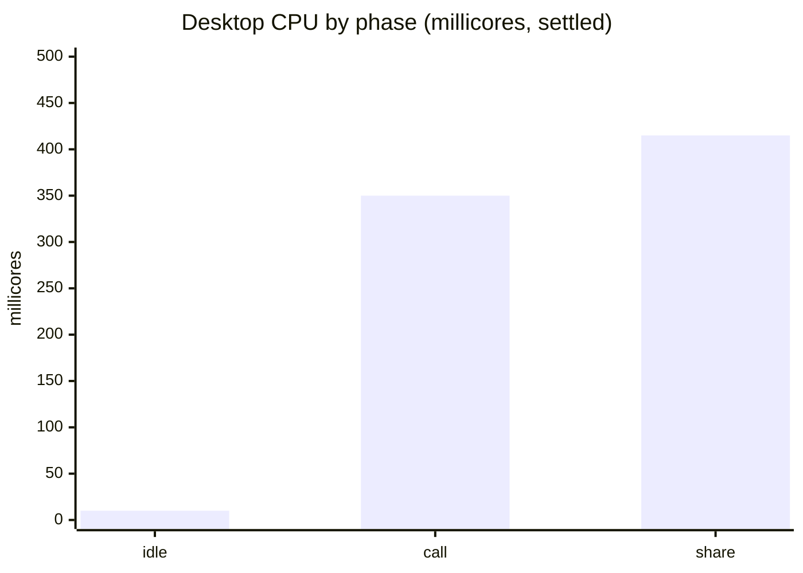

# k14 results: agent workspace desktops on k3d with KubeVirt

Plan: [`plan/2026-11-18-3-agent-workspace-k3d.md`](../plan/2026-11-18-3-agent-workspace-k3d.md),
step 15 (k14). All runs on p620, 2026-11-18 and 2026-11-19, k3d cluster `factory`
(server-0 and agent-0, agent-0 tainted `rfactory.io/desktops=true:NoSchedule`).
Fixes found during k14 are listed in the plan, deviations 39 and 40.

## Verdict: **not yet complete**

Every scripted check that has run passes, after the fixes in deviations 39 and 40.
Still open, both owner-gated:

- `e2e.sh` Teams half: needs the owner in a Teams meeting (4 checks not run).
- `profiles.sh`: its rollback rehearsal deletes and resyncs the ArgoCD
  Application `rfactory-desktops`, so it waits for the owner's OK.

## Images under test

| Component | Image |
|---|---|
| runner | `rfactory/runner@sha256:d0ea6eaed0526dab88c141cab7c7d9476dd53bcf7d1e905b01fdddbf8a8c1f57` |
| proxy | `rfactory/proxy@sha256:403ae8bdf73469fd6fbd82a6d8b45658ebb3a577e44a5e3139f285c3bc7aba7d` |
| guard | `rfactory/guard@sha256:cf072ecff2a27ebe6bd0667bc0671b6577bb1868c68f36428228f97f46970823` |
| reaper | `rfactory/reaper@sha256:5e56c7861109089273f19fba3e72f152c7cae757cfc2af18dc458cfbd58befd1` |
| guest boot | `rfactory-guest-boot:k2@sha256:d14ff034f328f6f53165361ed5e8208ba6684bf96bc030e4229d40845f73ddfd` |
| guest disk | `rfactory-guest-disk:k2@sha256:cda4840eca03a8b22a087a6652d800001cc176bccbff600223c4ecc78efbdb3e` |

These pins are live in the cluster and in `deploy/k8s/rfactory-desktops/`; ArgoCD
auto-sync is paused while k14 test mode is on, so factory-gitops still needs the
matching `targetRevision` bump.

## Checks

| Script | Result | Notes |
|---|---|---|
| `net.sh` | 33/33 (k10b, 2026-11-18 17:39) | Probe checks run only before the k11 taint (deviation 22); the k14 rerun refuses by design. The guard and proxy changed after k10b (3793afa, 38724f8, 00027f2); their k14 coverage is the real-desktop checks below (quota, share cutoff, reaper cut, handover). |
| `lifecycle.sh` | 10/10 | Overnight run 8/10; the two failures were test bugs (deviation 39), rerun passed: reaper alone cut egress at 53 s and deleted at 60 s. Runtime limit: gone at 10,810 s (limit 10,800). Runner killed: gone at 8 s, egress cut at 8 s. |
| `capacity.sh` | 5/5 scripted + 2 manual | 4th create refused, quota refuses, race gives one success, start-up printed. Rate and quota probe checks skipped (taint, deviation 22). The two owner items were run on real desktops: see below. |
| `handover.sh` | 14/15 | `handover-blocked-service-worker` not exercised: the fixture is plain HTTP on a private IP, so the page has no `navigator.serviceWorker`. |
| `secrets.sh` | 3/3 | |
| `share.sh` | 6/6 | Owner watched the Meet. `share-control-down` cut 14 s after the channel was dropped (5 s cutoff plus teardown). |
| `liveview.sh` | 7/7 | Revoke closes the stream within 5 s; second viewer 409. |
| `e2e.sh` | Meet 5/5, Teams 0/4 | Teams half not run (owner). |
| `profiles.sh` | not run | Owner OK needed (rollback rehearsal). |

### Manual capacity checks (real desktops)

- **1 GiB cutoff by the runner.** A desktop's launcher pod sent paced
  1400-byte UDP datagrams to a pinned Meet media address. The guard's
  counter stopped at 1,073,740,478 bytes and the desktop was gone 6 s
  later: no `list` entry, no VMI, no guard table. The reaper logged
  nothing and the runner held its Lease, so the runner's quota rule
  ended it. The runner does not log a destroy reason, so this is by
  elimination.
- **Share cutoff on runner loss.** A desktop in the Meet shared the
  fixture page (the observer participant saw it as a presentation);
  the runner was scaled to 0. Egress grew about 20 KB/s before and was
  flat from 0.4 s after the scale-down (limit 5 s); the bot left the
  call and nothing of the desktop remained.

## Measurements

One desktop, 2 vCPU and 6 GiB guest memory (requests = limits), on agent-0.
CPU and memory are `kubectl top` of the launcher pod's `compute`
container, sampled every 15 s, 8 samples per phase.

| Phase | CPU | Memory |
|---|---|---|
| Idle (guest up, no call) | 9–17 m | 1,465 MiB |
| In a Meet call | 318–1,019 m (settles at about 0.35 core) | 2,353 MiB |
| In a call and sharing a window | 408–636 m (settles at about 0.42 core) | 2,357 MiB |

Start-up, from the create call:

| Event | Time |
|---|---|
| `create` returns | 9.3 s |
| VMI `Running` | 9.4 s |
| Guest attached (first screenshot answers) | 28.2 s |
| Join to `in-call` in Meet | 18.1 s after the join call |

`capacity.sh` printed the same picture: create returned after 8 s, VMI running at 9 s.
The memory request (6 GiB plus overhead, 6,532 MiB on the pod) is what
limits density, not CPU: three desktops reserve about 19 GiB.

## Open findings

- Boot: about 2 in 40 boots the VMI did not reach `Paused` (it went
  `Failed` and its container restarted); cause not found yet.
- A share whose whole-screen capture the guard refused is recorded as
  started; the capture stays blocked (fails safe), but the record is wrong.
- The runner does not log why it destroyed a desktop.
- Google Meet refuses VM guest joins for about an hour after dozens of
  joins in a short time; tests space their joins.

## Evidence

Outputs, screenshots and the manual scripts are kept outside the repo in
`~/.config/rfactory-verify/record/` (`share-2026-11-19`, `e2e-2026-11-19`,
`runs-2026-11-19`); they hold no cookies or tokens.
