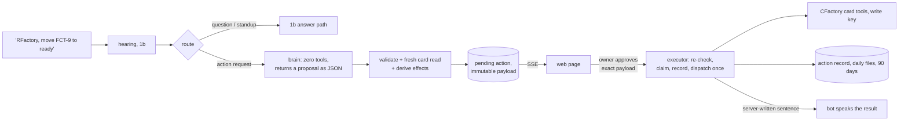

# Spec: Phase 3, act on the Factories from the call

## Design

### Where it sits

Phase 3 adds a **proposal → approval → execution** path next to 1b's
read path. The brain never gets a write tool or a key: it can only
*describe* a change. A small executor in the server performs an approved
change with its own `write` key.

### Recognising an action request

- In 1b's routing, after the leave check: if the addressed text asks for
  a change (create, make, add, update, change, rename, move, put,
  prioritise, run, start, build, plan, test, resume), it is an **action
  request**; otherwise a question or standup as today. This only routes;
  it never authorises anything.
- The brain gets the request (redacted, as untrusted content, as in 1b),
  the current snapshot, and a fixed system prompt
  (`claude-action-system-prompt.txt`): return **only** a JSON object
  `{ "action": <name>, "args": {...} }` or `{ "action": "none" }`; act
  only on the configured project; never invent card keys; when unsure,
  `none`. Same argv, environment, zero tools and destination check as 1a
  and 1b. Any text the brain writes is **not** spoken for an action.

### The action allowlist (the only things that can ever run)

| Action | CFactory tool | Arguments accepted from the brain |
|---|---|---|
| `create_card` | `cfactory_create_card` | `title` (1–200 chars), `acceptance_criteria` (0–20 items, each ≤ 500), `tier` (low/medium/hard), `status` (backlog/ready) |
| `update_card` | `cfactory_update_card` | `card_key`, and any of `title`, `acceptance_criteria`, `tier`, `assignee` (≤ 80), `milestone` (≤ 80) |
| `move_card` | `cfactory_move_card` | `card_key`, `status` (backlog/ready/in_progress/blocked/done) |
| `reprioritise_card` | `cfactory_reprioritise_card` | `card_key`, `priority` (0–1000) |
| `run_card` | `cfactory_run_card` | `card_key` |
| `plan_card` / `code_card` / `test_card` | the matching tool | `card_key` |

- Any other action, extra argument or out-of-bounds value is refused
  before anyone sees it; the bot says "I can't do that."
- `repository_id` and `issue_ref` are never accepted from the brain. For
  `create_card` the **server adds the configured `repository_id`** from
  the scope file, and it is part of the approved payload, so a new card
  always lands in the configured repository, never in CFactory's default.
- **Never allowed**, whatever the brain returns: `delete_card`,
  `import_cards`, `sync_card_github`, and every git connection,
  credential, install or repository tool. The executor maps action
  names to a fixed tool table; it has no generic "call tool" path.
- **Redaction must not change the payload:** if `toModel()` would alter
  any string in the arguments (for example a title containing
  `password=…`), the proposal is refused. So the payload that is shown,
  approved, executed and recorded is one and the same.

### Effects are derived, not trusted

Before a proposal is shown, the server reads the card **fresh** with
`cfactory_get_card` (read key; full card including `tier`, `status`,
`correlation_key` and `stage_runs`, which 1a's snapshot drops) and works
out what the action will do from the card's state before and after:

- **Starts work** when the action is `run_card`/`plan_card`/`code_card`/
  `test_card` (unless the stage is already done, see "Reading results"),
  or when the resulting card is in `ready` with a tier and has not been
  dispatched yet (no `correlation_key`). That covers `create_card` into
  `ready`, `move_card` to `ready`, and the less obvious cases CFactory's
  intake hook also triggers: `update_card` adding a tier to a ready card,
  and `reprioritise_card` on a ready, tiered, undispatched card.
- **Opens or updates a GitHub issue** for card writes that CFactory syncs
  to GitHub.
- Every action that starts work counts against the **run budget of 10
  per call**.
- The bot's sentence and the page's description are **written by the
  server** from the validated payload and the derived effects (for
  example "Move FCT-9, 'Dark theme', from backlog to ready. This starts a
  build in AIFactory and updates its GitHub issue. Approve it on the
  RFactory page."). The model's wording is never spoken.

### Pending actions and approval

- A valid proposal becomes a **pending action** with an **immutable
  payload**: `{ id, action, args (including server-added repository_id),
  effects, card_key, card_updated_at, proposed_by (caption display name,
  not verified), proposed_at, expires_at }` and `hash` = SHA-256 of the
  canonical JSON of the payload.
- **At most 5 pending** at once; a 6th proposal is declined aloud.
- **Expiry:** 10 minutes, the end of the call, or when the card's
  `updated_at` has changed, whichever comes first.
- **Approval:** the page lists pending actions with the exact payload,
  effects and Approve / Reject. Only emails in `RFACTORY_APPROVERS` (the
  owner, decision 1) may approve or reject; checked on every request from
  the oauth2-proxy identity, as 1a. `POST /api/actions/:id/approve|reject`
  carries the `hash` the page showed and requires the header
  `X-RFactory-Action: 1` and a same-origin `Origin`; a mismatched hash,
  a missing header or a foreign origin is refused (a cross-site form
  cannot approve, and an approval cannot apply to a payload the approver
  did not see).
- There is no code path from captions or chat to approval.

### Execution: re-check, claim, record, dispatch once

On approval, in this order:

1. **Claim, synchronously:** in one synchronous step (no `await` between
   check and change), move the action from `pending` to `executing` only
   if it is still `pending`, and reserve a run-budget slot if it starts
   work. A second approval of the same action, or any action that would
   exceed the budget, is refused here. Node runs this step without
   interleaving, so two concurrent approvals cannot both pass.
2. **Persist:** append `approved` and `executing` to the action record
   and wait until the write completes. If the record cannot be written,
   release the claim and fail without calling CFactory.
3. **Re-check against a fresh read** (`cfactory_get_card`, not the 60 s
   cached snapshot): writes still enabled; not expired; the card still
   belongs to the configured repository; `updated_at` unchanged; the
   payload still passes the allowlist; the effects still match what was
   shown. Any difference ends the action as `expired` or `refused` and
   releases the budget slot; nothing is sent.
4. **Dispatch once** through the fixed tool table, with the write key.
5. **Read the result** (below), record the final state, release an
   unused budget slot if no work started, and the bot says the
   server-written result sentence.

- After a restart, any action found in `executing` without a final state
  is recorded as `uncertain`; it is never re-run.

### Reading CFactory's results

CFactory returns domain errors inside a normal MCP text reply (no
`isError`), and stage tools report `dispatched` and `skipped` inside a
success. So the executor parses the JSON reply and classifies it:

- `done`: the write applied and, for work-starting actions,
  `dispatched: true`.
- `already done`: `ok: true` with `dispatched: false` / `skipped` (for
  example a stage that already completed); the bot says "FCT-7's build
  already finished" rather than "is building", and the budget slot is
  released.
- `failed`: an explicit `ok: false` or error before any change; the bot
  says so with the reason.
- `uncertain`: a timeout, a lost connection, a reply that cannot be
  parsed, or a generic internal error, since the change may have
  happened; the bot says "I'm not sure that went through; check the
  board", and the page shows the card from a fresh read. Never retried.

### Keys and switches

- Writes use a **separate `write`-scoped CFactory key**, read from its
  own key file only by the executor; never in the brain's prompt,
  environment or any log, event or record.
- Writes are on only when the scope file says `writes_enabled: true`
  **and** the environment says `RFACTORY_WRITES=on` **and** the write key
  file exists; otherwise the action path answers "Changes are turned off
  here." `loadScope` keeps refusing `writes_enabled: true` without the
  other two (#2's rule, extended).

### The action record

- Append-only JSON lines, one per state change (`proposed`, `approved`,
  `rejected`, `expired`, `refused`, `executing`, `done`, `already done`,
  `failed`, `uncertain`), with the action id, the exact payload and hash,
  effects, proposer (display name), approver (email), times and the
  classified result. Logs and the record never contain a key.
- **Daily files** `/var/lib/rfactory/actions/YYYY-MM-DD.jsonl` on a
  persistent pod volume. A file is deleted once its date is more than 90
  days before today (UTC), checked at start-up and daily (decision 6).
  This is the only data Phase 3 keeps after a call.

### Web page

- A **Pending actions** panel in the Factory style: each pending action
  with the server-written description, the exact payload, effects,
  proposer ("display name, not verified"), time left, and Approve /
  Reject (only for approvers).
- A **History** list for the call: every final state with who approved
  and the result.
- Live through the 1b event stream (`action-pending`, `action-updated`),
  replayed on reload like the call state.

## Alternatives rejected

- **Giving the brain write tools** behind a confirmation prompt: the
  brain would hold the capability and could be talked into using it.
- **Voice approval:** caption names can be spoofed (parent intent).
- **Speaking the model's own sentence:** a crafted request could make it
  describe one card while proposing another.
- **Parsing commands with fixed patterns only:** brittle with
  mis-captioned speech; the brain turns speech into a proposal, and the
  allowlist plus derived effects keep it safe.
- **One key with read and write:** the read path would hold write power.
- **Monthly record files:** cannot enforce exactly 90 days.

## Risks

- **A wrong but valid proposal** (misheard card key): the page and the
  bot show card key and title together, and the approver checks.
- **Approval fatigue:** effects in plain words, at most 5 pending.
- **The write key is powerful** (CFactory `write` allows deletes and git
  changes): only the executor reads it, through a fixed tool table; tests
  prove the never-allowed tools are unreachable.
- **CFactory down or slow:** `failed` or `uncertain`, never retried.
- **The record holds call content** for 90 days on p620.

## Verification

1. Unit tests (no network):
   - every allowlisted action with valid and out-of-bounds arguments;
     unknown actions, extra arguments, `repository_id`/`issue_ref` from
     the brain, and every never-allowed tool refused; card keys outside
     the configured project refused;
   - `create_card` carries the configured `repository_id`;
   - a proposal whose arguments would change under redaction is refused;
   - derived effects: move to ready, create into ready, **update adding a
     tier to a ready card**, **reprioritise of a ready undispatched
     card**, a stage already done; the run budget counts all of them;
   - the spoken and shown sentence comes from the payload, never from
     the model's text;
   - pending limit (5); expiry by time, call end and card change;
   - approval only by `RFACTORY_APPROVERS`, with the custom header, same
     origin and the matching hash;
   - **two concurrent approvals** of one action: one executes; two
     approvals competing for the last budget slot: one executes;
   - record write failure: nothing is sent;
   - re-check with a changed card at execution: nothing is sent;
   - result classification: `ok:false` → failed; `dispatched:false` /
     `skipped` → already done; a timeout and an unparsable reply →
     uncertain, never retried; restart with an `executing` record →
     uncertain;
   - the write key never in the brain's stdin, environment, events, logs
     or record; daily-file pruning at exactly 90 days; writes off unless
     all three switches are on.
2. **Live on p620** (owner's OK), after adding a `write` key to CFactory:
   in a Meet, "RFactory, create a card 'Phase 3 smoke test' in backlog" →
   pending on the page → approve → the card exists in the configured
   repository; "move it to done" → approve → done; a rejected proposal
   leaves CFactory unchanged; "delete FCT-9" → refused aloud; a
   non-approver account cannot approve (403); "build FCT-6" after its
   build finished → "already finished".
