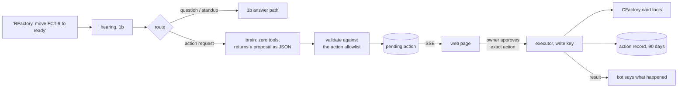

# Spec: Phase 3, act on the Factories from the call

## Design

### Where it sits

Phase 3 adds a **proposal → approval → execution** path next to 1b's
read path. The brain never gets a write tool or a key: it can only
*describe* a change. A separate, small executor in the server performs an
approved change with its own `write` key.

### Recognising an action request

- In 1b's routing, after the leave check: if the addressed text asks for
  a change (verbs such as create, make, add, update, change, rename,
  move, put, prioritise, run, start, build, plan, test, resume), it is an
  **action request**; otherwise a question or standup as today. The
  word list only routes to the proposal path; it never authorises
  anything.
- The brain gets the request (redacted, as untrusted content, as in 1b),
  the current snapshot, and a third fixed system prompt
  (`claude-action-system-prompt.txt`): return **only** a JSON object
  `{ "action": <name>, "args": {...}, "say": "<one sentence>" }` or
  `{ "action": "none", "say": "<why>" }`; act only on the configured
  project; never invent card keys; when unsure, `none`. Same argv,
  environment, zero tools and destination check as 1a and 1b.

### The action allowlist (the only things that can ever run)

| Action | CFactory tool | Arguments allowed | Side effect stated by the bot |
|---|---|---|---|
| `create_card` | `cfactory_create_card` | `title` (1–200 chars), `acceptance_criteria` (0–20 items, each ≤ 500), `tier` (low/medium/hard), `status` (backlog/ready) | "status ready with a tier starts work" |
| `update_card` | `cfactory_update_card` | `card_key`, and any of `title`, `acceptance_criteria`, `tier`, `assignee` (≤ 80), `milestone` (≤ 80) | none |
| `move_card` | `cfactory_move_card` | `card_key`, `status` (backlog/ready/in_progress/blocked/done) | moving a tiered card to `ready` starts work |
| `reprioritise_card` | `cfactory_reprioritise_card` | `card_key`, `priority` (0–1000) | none |
| `run_card` | `cfactory_run_card` | `card_key` | starts or resumes plan → build → test |
| `plan_card` / `code_card` / `test_card` | the matching tool | `card_key` | starts that stage |

- Any other action name, any extra argument, or an argument outside its
  bounds is refused before it is shown to anyone; the bot says "I can't
  do that." `repository_id` and `issue_ref` are never accepted, so every
  card stays in the configured project.
- `card_key` must exist in the current snapshot of the configured
  project (the same scope rules as 1a); otherwise refused.
- **Never allowed**, whatever the brain returns: `delete_card`,
  `import_cards`, `sync_card_github`, and every git connection,
  credential, install or repository tool. The executor maps action names
  to a fixed tool table; it has no generic "call tool" path.
- **Run budget:** actions that start work (`run_card`, `plan_card`,
  `code_card`, `test_card`, and a create or move into `ready` with a
  tier) count against **10 per call**; the 11th is refused.

### Pending actions and approval

- A valid proposal becomes a **pending action**: `{ id, action, args,
  effect, proposed_by (caption speaker, display name, not verified),
  proposed_at, expires_at, card_updated_at }`. The bot says the `say`
  sentence plus the side effect ("…This starts a build in AIFactory.")
  and "Approve it on the RFactory page."
- **At most 5 pending** at once; a 6th proposal is declined aloud.
- **Expiry:** 10 minutes, the end of the call, or when the card's
  `updated_at` changes before approval (checked again at approval),
  whichever comes first.
- **Approval:** the web page lists pending actions with the exact action
  and arguments, and Approve / Reject buttons. Only emails in
  `RFACTORY_APPROVERS` (the owner, decision 1) may approve or reject; it
  is checked on every request, from the oauth2-proxy identity, as 1a.
  `POST /api/actions/:id/approve|reject` requires the header
  `X-RFactory-Action: 1` and a same-origin `Origin`, so a cross-site form
  cannot approve. The approval binds the action id, the exact `args` and
  a hash of both; changing anything needs a new proposal.
- Voice or chat cannot approve: there is no code path from captions or
  chat to approval.

### Execution, at most once

- The executor runs an approved action **once**: it marks the action
  `executing` before calling CFactory, and never calls it again for that
  id.
- On success it records the result and the bot says what happened
  ("FCT-12 created", "FCT-9 is building").
- On an error response it records `failed` with the reason; the bot says
  so.
- On a timeout or lost connection the outcome is **uncertain**: it
  records `uncertain`, the bot says "I'm not sure that went through;
  check the board", and the page shows the card state from a fresh read.
  It never retries. A person can propose again.
- Writes use a **separate `write`-scoped CFactory key**, held only by the
  executor (never in the brain's prompt, environment or logs), read from
  its own key file.
- Writes are on only when the scope file says `writes_enabled: true`
  **and** the environment says `RFACTORY_WRITES=on` **and** the write key
  file exists; otherwise the action path answers "Changes are turned off
  here." This extends #2's rule (writes off unless the deployment turns
  them on); `loadScope` keeps refusing `writes_enabled: true` without the
  other two.

### The action record

- Append-only JSON lines, one per state change (`proposed`, `approved`,
  `rejected`, `expired`, `executing`, `done`, `failed`, `uncertain`),
  with the action id, action, args, effect, proposer (display name),
  approver (email), times and the CFactory result summary. All through
  `toModel()`/`logSafe` (no keys, no secrets).
- Stored at `/var/lib/rfactory/actions/YYYY-MM.jsonl` on a persistent pod
  volume; files older than 90 days are deleted on start-up and daily
  (decision 6). This is the only data Phase 3 keeps after a call.

### Web page

- A **Pending actions** panel in the Factory style: each pending action
  with its exact change, side effect, proposer ("display name, not
  verified"), time left, and Approve / Reject (only for approvers).
- A **History** list for the call: approved, rejected, expired, done,
  failed, uncertain, with who approved and the result.
- Live through the 1b event stream (new event types `action-pending`,
  `action-updated`), replayed on reload like the call state.

## Alternatives rejected

- **Giving the brain write tools** behind a confirmation prompt: the
  brain would hold the capability and could be talked into using it; an
  approval outside the model is the only safe gate.
- **Voice approval:** caption names can be spoofed (parent intent).
- **Parsing commands with fixed patterns only:** brittle with
  mis-captioned speech; the brain turns free speech into a proposal, and
  the allowlist validation is what keeps it safe.
- **CFactory's own approval flow:** none exists for card writes.
- **One key with read and write:** the read path would then hold write
  power; separate keys keep 1a and 1b's read-only guarantee.

## Risks

- **A wrong but valid proposal** (the brain misheard "FCT-9" as "FCT-5"):
  the page shows the exact card and change before approval; the
  approver is the check. Mitigation: card key and title shown together.
- **Approval fatigue:** approving without reading. Mitigation: side
  effects in plain words, at most 5 pending.
- **The write key is powerful** (CFactory `write` allows deletes and git
  changes). Mitigation: only the executor reads it, through a fixed
  tool table with no generic call; tests prove the never-allowed tools
  are unreachable.
- **CFactory down or slow:** actions end `failed` or `uncertain`, never
  retried.
- **The record holds call content** (titles and criteria people spoke)
  for 90 days on p620.

## Verification

1. Unit tests (no network): every allowlisted action with valid and
   out-of-bounds arguments; unknown actions, extra arguments,
   `repository_id`/`issue_ref`, and every never-allowed tool refused;
   card keys outside the snapshot refused; the run budget (10) and the
   pending limit (5); expiry by time, call end and card change; approval
   only by `RFACTORY_APPROVERS`, with the custom header and same origin,
   bound to the exact args; execution exactly once, including a timeout
   recorded as `uncertain` and never retried; the write key never in the
   brain's stdin, environment or any log or event; the record's
   redaction and the 90-day prune; writes off unless all three switches
   are on.
2. **Live on p620** (owner's OK), with a new `write` key added to
   CFactory: in a Meet, "RFactory, create a card 'Phase 3 smoke test' in
   backlog" → pending on the page → approve → the card exists in
   CFactory; "move it to done" → approve → done; a rejected proposal
   leaves CFactory unchanged; "delete FCT-9" → refused aloud; a
   non-approver account cannot approve (403).
