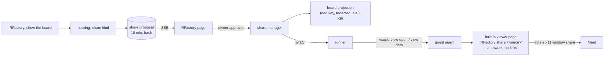

# Spec: Show the CFactory board in the call

## Design

### The constraint that shapes it

The intent's decision 1 keeps #3's isolation as approved. #3's network
rules drop the host, the cluster and the Factory hosts unconditionally
(#3 spec 97–104), so the per-call desktop cannot reach **RFactory's web
server either**, and it holds no credential, so it could not pass
oauth2-proxy anyway. A view "drawn by RFactory" therefore cannot be a URL
the desktop loads.

The desktop's only link back is #3's control channel (vsock, schema-checked
JSON, 64 KiB per message, #3 spec 81–90), which the runner already uses to
send driving commands *into* the guest. So:

**RFactory sends board data over the control channel, and a viewer page
built into the desktop image draws it.** No network path, no sign-in, no
change to #3's network rules.



### What is shown: the board projection

- New `boardView()` in `core/src/sources/cfactory.js`: one live
  `cfactory_list_cards` + repository list (the read key, as 1a), filtered
  to the configured repository, projected from the **raw** cards (1a's
  `mapCard` drops priority, tier and stage states) to **only**:

  ```text
  { project: string ≤ 80, at: ISO time,
    columns: { backlog|ready|in_progress|blocked|done:
               { total: int, shown: int, omitted: int } },
    cards: [{ key: string ≤ 16, title: string ≤ 120,
              column: backlog|ready|in_progress|blocked|done,
              priority: int | null, tier: low|medium|hard | null,
              stages: { plan|code|test: none|queued|running|done|failed|unknown } }] }
  ```

  Card status maps to the five columns as CFactory names them; any other
  status is dropped and counted in that card's nearest column as omitted.
  Stage state comes from the card's latest `stage_runs` entry per stage:
  `queued`/`dispatched` → queued, `running`/`in_progress` → running,
  `succeeded`/`done` → done, `failed`/`error` → failed, no run → none,
  anything else → unknown.
- Never included: descriptions, acceptance criteria, comments, assignee
  emails, GitHub URLs, run logs, anything from another repository.
- **Redaction, then a title guard, then truncation.** Every string passes
  `redactor.logSafe` first. Redaction only catches configured secret
  values and known token patterns, so a title with an unknown secret
  ("DB password: horse-battery") would survive it. A title guard therefore
  replaces any title matching `(password|passwd|secret|token|api[ _-]?key|
  credential)s?\s*[:=]` (case-insensitive) with "[title hidden]". This
  lowers the risk; it cannot prove a title is safe. What is shown is the
  configured project's card titles as written in CFactory, and the
  owner's approval is the check that the audience may see them.
- **Size cap:** measured on the UTF-8 JSON **after** redaction and
  truncation; at most 48 KiB (room inside #3's 64 KiB message). Over the
  cap, cards are removed `done` first, then the least recently updated in
  each other column, and each column's `omitted` count says how many
  ("+N more"). If the fixed fields alone exceed the cap, the share is not
  started and the bot says the board is too large.
- Read at approval and then every 30 s while the share runs, at most one
  read in flight; a failed read keeps the last frame and marks it stale
  (shown as "as of hh:mm").

### The viewer page (in the desktop image)

- `desktop/guest/agent/viewer/board.html` + `board.js` + `board.css`,
  built into the guest image with #3's agent, not fetched.
- **One fixed target.** The viewer lives at the constant URL
  `https://rfactory-viewer.invalid/board.html` (`.invalid` never resolves).
  The guest agent opens it in its own share page whose Playwright route
  handler **fulfils exactly** `/board.html`, `/board.js` and `/board.css`
  from the image files and aborts every other request; service workers
  are blocked, as #3 does for every page. Nothing reaches the network.
- **Mapping onto #3's share contract** (#3 plan 190–214): the share
  approval record is `{ share_id, nonce, url:
  'https://rfactory-viewer.invalid/board.html', origin:
  'https://rfactory-viewer.invalid' }`; that origin is the only `hosts`
  entry for the share page; #3's rules apply unchanged: title locked to
  `RFactory share <nonce>`, any navigation (even same-origin), popup or
  window change stops the share with `share-target-changed`, and driving
  tools (`desktop_open/click/type`) are refused on the shared page. The
  brain cannot name a URL for this share: `view: 'board'` maps to the
  constant on the server and again in the guest.
- **Live updates are part of the approved target.** The approval reads
  "Share the live CFactory board of <project>, refreshed every 30
  seconds". New board data for the same view is not a change of what is
  shown; a different view or project is, and needs a new approval
  (decision 5).
- CSP `default-src 'none'; script-src 'self'; style-src 'self'` on the
  fulfilled HTML. No links, no forms, no inputs.
- Renders with `createElement` + `textContent` only (as `web/public`),
  in the Factory style: five columns, card key, title, priority, stage
  pills. A fixed banner: "RFactory (AI) · CFactory board · read-only · as
  of hh:mm".
- Its window is #3's share window: title `RFactory share <nonce>`, title
  locked, consent bound to it (#3 plan 190–214). Any navigation, popup or
  window change stops the share (`share-target-changed`).

### Control-channel additions (an additive change to #3)

Three host→guest message types and one reply, schema-checked like #3's others:

- `view-open { share_id, nonce, view: 'board', data }`: the guest agent
  opens the viewer as the share window for that nonce and draws `data`.
- `view-data { share_id, data }`: redraws the open viewer; ignored unless
  `share_id` matches the open share.

- `view-close { share_id }`: closes the viewer and drops its data;
  answered by `view-closed { share_id }` guest→host (a new reply type,
  like #3's `cancel-ack`).

`view` accepts only `'board'`; `data` is validated against the projection
schema in the guest too. Guest→host stays as in #3 (it already reports
`share-target-changed`). This is recorded as a #3 deviation when built: it
adds message types, not reach or credentials.

### Proposing, approving, stopping

- **Hearing:** after leave and before action (#10 D7): an utterance
  starting with "show", "display", "share" or "put up" plus "board" is a
  **share request**. Anything else stays as today.
- **Share manager** `web/shares.js`, following `web/actions.js`'s proven
  pattern (frozen payload, SHA-256 hash, 10-minute lifetime, call
  generation, single synchronous claim, events, record) but its own
  module: it must exist with writes off and has no card writes or budget.
  Payload: `{ id, view: 'board', project, proposed_by (display name, not
  verified), proposed_at, expires_at }`.
- At most **1 pending** and **1 running** share per call. A new proposal
  while one runs is allowed; approving it stops the running share first,
  then starts the new one (every change of view is a fresh approval,
  decision 5).
- **Approval:** `POST /api/shares/:id/approve|reject` with `{ hash }`, the
  `X-RFactory-Action: 1` header, same-origin `Origin`, and the oauth2-proxy
  email in `RFACTORY_APPROVERS` (the owner, decision 4; the same list as
  #10, not #3's scope approvers). `POST /api/shares/stop` with the same
  header and origin checks stops the running share for **any** signed-in
  user on the allowlist (stopping is always safe).
- **States and a start token.** A share moves `pending → starting →
  running → stopping → stopped` (or `failed`). Approval claims it
  synchronously and gives it a fresh **start token**. After every await
  in starting (board read, `view-open`, #3's share start) the manager
  checks the token is still current; Stop, expiry, call end or a
  replacement invalidates it, and a start that finds its token stale
  sends `view-close` and #3's stop instead of going on. The guest refuses
  `view-open`/`view-data` for any `share_id` other than the one it was
  told to open.
- **Stop:** the stop route, call end, the desktop or controller going
  away, a failed `view-open`, #3's `share-target-changed`, or the **share
  lifetime of 30 minutes** (independent of call-end detection; sharing
  longer needs a new approval). Stop: invalidate the token, clear the
  refresh timer, drop the cached board data, send #3's stop and
  `view-close`, and wait up to 5 s for `view-closed`. No answer: retry
  once, then the runner destroys the desktop (#3's rule for a lost
  control channel) and the failure is recorded and shown on the page.
  A replacement share starts only after the old one is `stopped`.
- The page shows "Sharing: CFactory board" with Stop while it runs.
- **Spoken:** the bot reads a server-written sentence: "I'd like to share
  the CFactory board. Approve it on the RFactory page." / "Sharing the
  board." / "Stopped sharing." / "I can't share the board right now:
  <reason>." Model text is never spoken (as #10).
- **Unavailable** (no desktop for this call, shares switched off, CFactory
  read fails, the desktop refuses): the bot says so, the page shows why,
  nothing else is shared instead (intent decision 2).

### Switches and record

- Shares are on only when the scope says `shares_enabled: true` and the
  environment says `RFACTORY_SHARES=on`, and the call has a #3 desktop.
  Off means the share request is answered "Sharing is turned off here."
- Each state change (`proposed`, `approved`, `rejected`, `expired`,
  `started`, `stopped` with reason, `failed`) is appended to #10's daily
  action record, with the share id, view and approver; never the board
  data.
- `web/server.js` builds that record whenever writes **or** shares are
  on (today it is built only inside `if (scope.writes_enabled)`), with no
  writer when writes are off. After a restart, a share found `starting`
  or `running` is recorded `stopped (restart)`; the desktop went with the
  old process's call.

### Order and dependencies

1. **#1's share check D5 passes** on p620 (never run so far). Needs the
   owner's Meet link and OK.
   If D5 fails, #3's spec needs a loopback design, **approved again**
   (#3 spec 29–32), before #3 or #12 builds any share.
2. **#3's step 11** (window share) and steps 13–14 (desktop routes and
   page wiring) are built. #3's plan blocks steps 13–14 until #2's roles
   and the other prerequisites are on main (#3 plan 470–480), so #12
   waits for #2's roles **through #3**, even though #12's own approval
   uses `RFACTORY_APPROVERS` rather than roles.
3. #12 is built on top: projection, viewer, the two message types, the
   share manager, routes, page panel.

## Alternatives rejected

- **The desktop loads an RFactory URL:** RFactory is inside #3's
  unconditional drops and behind oauth2-proxy; reaching it needs a new
  network exception and a credential on the desktop (intent decision 1).
- **The real Factory portals:** reach plus a sign-in on the desktop
  (decision 1).
- **Sharing RFactory's own standup page:** it carries Join/Leave, Approve
  buttons, portal links and needs a sign-in.
- **Pushing a rendered image instead of data:** a readable board image
  exceeds the 64 KiB message and would need chunking; data plus a fixed
  renderer is smaller, sharper and keeps text as text.
- **Sharing from the bot's call browser before #3:** ruled out by decision
  3 and #3's separate control and call browsers.

## Risks

- **Blocked for a while:** D5 has never run, and #3's steps 11, 13 and 14
  are unbuilt. If D5 fails, #3's spec needs its loopback update first, and
  #12 waits with it.
- **A #3 protocol change:** two new message types; small, schema-checked,
  host→guest only, but it touches #3's approved design and is recorded as
  a deviation there.
- **What the board shows:** titles of the configured project are visible
  to everyone in the call. Redaction and the title guard lower the chance
  of a secret in a title; they cannot rule it out. The owner's approval is
  the check that the audience is right.
- **Long dependency chain:** D5 → #3 steps 11, 13, 14 → #2's roles. #12
  may wait a long time; nothing in #12 is built before them.
- **Hostile titles:** a card title is untrusted text; it is drawn as text,
  cannot navigate, and never reaches the brain from the viewer.

## Verification

1. Unit tests (no network):
   - `boardView`: only the listed fields; other repositories dropped;
     redaction applied (`password=…`, `cfk_…` in a title); the title guard
     hides "DB password: horse-battery"; redaction runs before truncation
     (a secret split at character 120 is still removed); 48 KiB cap on
     UTF-8 bytes with multibyte and escaped titles; `done` cut first and
     `omitted` counts right; fixed fields over the cap → not started;
     every stage mapping, including unknown values.
   - viewer **in real headless Chrome** (Playwright, no network): renders
     with `textContent` only; a hostile title (``, a URL)
     stays text; the CSP is enforced (an injected `fetch` and an external
     image fail); any path other than the three files is aborted; a
     same-origin navigation, a popup or a window change stops the share
     with `share-target-changed`.
   - protocol: `view-open`/`view-data`/`view-close` accepted only with
     `view: 'board'`, a valid schema and the open `share_id`; oversize
     refused; `view-closed` answered.
   - share manager: owner-only approve (403 otherwise), header, origin and
     hash checks; 10-minute expiry; 30-minute share lifetime; two
     concurrent approvals start one share; **Stop, expiry, call end and a
     replacement while the board read or `view-open` is delayed** never
     lead to a share starting; a replacement starts only after
     `view-closed`; no `view-closed` → one retry, then the desktop is
     destroyed and the failure recorded; stop by any allowlisted user.
   - server composition with **writes off and shares on**: the record is
     built and written, no writer exists, and a restart records a running
     share as `stopped (restart)`; shares off answers aloud.
   - hearing: "show the board" is a share; "show me what's blocked" stays
     a question; leave and actions unchanged.
2. **Live on p620** (owner's OK, after D5 and #3 step 11): "RFactory, show
   the board" → approve → Meet shows the board window only; Stop ends it
   at once; a second "show the board" needs a new approval; a non-owner
   cannot approve (403); an unapproved proposal expires after 10 minutes.
