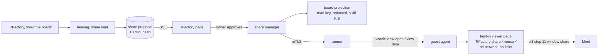

# Spec: Show the CFactory board in the call

## Design

### The constraint that shapes it

The intent's decision 1 keeps #3's isolation as approved. #3's network
rules drop the host, the cluster and the Factory hosts unconditionally
(#3 spec 97–104), so the per-call desktop cannot reach **RFactory's web
server either**, and it holds no credential, so it could not pass
oauth2-proxy anyway. A view "drawn by RFactory" therefore cannot be a URL
the desktop loads.

The desktop's only link back is #3's control channel (vsock, schema-checked
JSON, 64 KiB per message, #3 spec 81–90), which the runner already uses to
send driving commands *into* the guest. So:

**RFactory sends board data over the control channel, and a viewer page
built into the desktop image draws it.** No network path, no sign-in, no
change to #3's network rules.

### What is shown: the board projection

- New `boardView()` in `core/src/sources/cfactory.js`: one live
  `cfactory_list_cards` + repository list (the read key, as 1a), filtered
  to the configured repository, projected to **only**:
  `{ project, at, columns: { backlog, ready, in_progress, blocked, done },
  cards: [{ key, title, column, priority, tier, stages: { plan, code, test } }] }`,
  where each stage is one of `none | queued | dispatched | running | done |
  failed`.
- Never included: descriptions, acceptance criteria, comments, assignee
  emails, GitHub URLs, run logs, anything from another repository.
- Every string passes `redactor.logSafe` (the same redactor as the brain
  and the action record); titles are cut to 120 characters.
- **Size cap:** the encoded projection stays under 48 KiB (room inside
  #3's 64 KiB message). Over the cap, each column keeps its most recently
  updated cards and shows "+N more"; `done` is cut first.
- Read at approval and then every 30 s while the share runs, at most one
  read in flight; a failed read keeps the last frame and marks it stale
  (shown as "as of hh:mm").

### The viewer page (in the desktop image)

- `desktop/guest/agent/viewer/board.html` + `board.js` + `board.css`,
  built into the guest image with #3's agent, not fetched.
- CSP `default-src 'none'; script-src 'self'; style-src 'self'`; the
  control Chrome's route handler for the share page aborts every request
  except the viewer's own files. No links, no forms, no inputs.
- Renders with `createElement` + `textContent` only (as `web/public`),
  in the Factory style: five columns, card key, title, priority, stage
  pills. A fixed banner: "RFactory (AI) · CFactory board · read-only · as
  of hh:mm".
- Its window is #3's share window: title `RFactory share <nonce>`, title
  locked, consent bound to it (#3 plan 190–214). Any navigation, popup or
  window change stops the share (`share-target-changed`).

### Control-channel additions (an additive change to #3)

Two host→guest message types, schema-checked like #3's others:

- `view-open { share_id, nonce, view: 'board', data }`: the guest agent
  opens the viewer as the share window for that nonce and draws `data`.
- `view-data { share_id, data }`: redraws the open viewer; ignored unless
  `share_id` matches the open share.

`view` accepts only `'board'`; `data` is validated against the projection
schema in the guest too. Guest→host stays as in #3 (it already reports
`share-target-changed`). This is recorded as a #3 deviation when built: it
adds message types, not reach or credentials.

### Proposing, approving, stopping

- **Hearing:** after leave and before action (#10 D7): an utterance
  starting with "show", "display", "share" or "put up" plus "board" is a
  **share request**. Anything else stays as today.
- **Share manager** `web/shares.js`, following `web/actions.js`'s proven
  pattern (frozen payload, SHA-256 hash, 10-minute lifetime, call
  generation, single synchronous claim, events, record) but its own
  module: it must exist with writes off and has no card writes or budget.
  Payload: `{ id, view: 'board', project, proposed_by (display name, not
  verified), proposed_at, expires_at }`.
- At most **1 pending** and **1 running** share per call. A new proposal
  while one runs is allowed; approving it stops the running share first,
  then starts the new one (every change of view is a fresh approval,
  decision 5).
- **Approval:** `POST /api/shares/:id/approve|reject` with `{ hash }`, the
  `X-RFactory-Action: 1` header, same-origin `Origin`, and the oauth2-proxy
  email in `RFACTORY_APPROVERS` (the owner, decision 4; the same list as
  #10, not #3's scope approvers). `POST /api/shares/stop` with the same
  header and origin checks stops the running share for **any** signed-in
  user on the allowlist (stopping is always safe).
- **Stop:** the stop route, call end, the desktop going away, a failed
  `view-open`, or #3's `share-target-changed`. Stop sends #3's stop and
  closes the viewer window; the page shows "Sharing: CFactory board" with
  Stop while it runs.
- **Spoken:** the bot reads a server-written sentence: "I'd like to share
  the CFactory board. Approve it on the RFactory page." / "Sharing the
  board." / "Stopped sharing." / "I can't share the board right now:
  <reason>." Model text is never spoken (as #10).
- **Unavailable** (no desktop for this call, shares switched off, CFactory
  read fails, the desktop refuses): the bot says so, the page shows why,
  nothing else is shared instead (intent decision 2).

### Switches and record

- Shares are on only when the scope says `shares_enabled: true` and the
  environment says `RFACTORY_SHARES=on`, and the call has a #3 desktop.
  Off means the share request is answered "Sharing is turned off here."
- Each state change (`proposed`, `approved`, `rejected`, `expired`,
  `started`, `stopped` with reason, `failed`) is appended to #10's daily
  action record, with the share id, view and approver; never the board
  data.

### Order and dependencies

1. **#1's share check D5 passes** on p620 (never run so far). Needs the
   owner's Meet link and OK.
2. **#3's step 11** (window share) and steps 13–14 (desktop routes and
   page wiring) are built. #12's own routes use `RFACTORY_APPROVERS`, so
   they do not wait for #2's roles.
3. #12 is built on top: projection, viewer, the two message types, the
   share manager, routes, page panel.

## Alternatives rejected

- **The desktop loads an RFactory URL:** RFactory is inside #3's
  unconditional drops and behind oauth2-proxy; reaching it needs a new
  network exception and a credential on the desktop (intent decision 1).
- **The real Factory portals:** reach plus a sign-in on the desktop
  (decision 1).
- **Sharing RFactory's own standup page:** it carries Join/Leave, Approve
  buttons, portal links and needs a sign-in.
- **Pushing a rendered image instead of data:** a readable board image
  exceeds the 64 KiB message and would need chunking; data plus a fixed
  renderer is smaller, sharper and keeps text as text.
- **Sharing from the bot's call browser before #3:** ruled out by decision
  3 and #3's separate control and call browsers.

## Risks

- **Blocked for a while:** D5 has never run, and #3's steps 11, 13 and 14
  are unbuilt. If D5 fails, #3's spec needs its loopback update first, and
  #12 waits with it.
- **A #3 protocol change:** two new message types; small, schema-checked,
  host→guest only, but it touches #3's approved design and is recorded as
  a deviation there.
- **What the board shows:** titles of the configured project are visible
  to everyone in the call. Redaction removes secrets; the owner's approval
  is the check that the audience is right.
- **Hostile titles:** a card title is untrusted text; it is drawn as text,
  cannot navigate, and never reaches the brain from the viewer.

## Verification

1. Unit tests (no network):
   - `boardView`: only the listed fields; other repositories dropped;
     redaction applied (`password=…`, `cfk_…` in a title); 120-character
     cut; 48 KiB cap keeps recent cards and adds "+N more", `done` first;
     stage mapping.
   - viewer: renders a fixture with `textContent` only; a hostile title
     (``, a URL) stays text; no element has `href`, `src` to
     the network or an input; CSP present.
   - protocol: `view-open`/`view-data` accepted only with `view: 'board'`,
     a valid schema and the open `share_id`; oversize refused.
   - share manager: owner-only approve (403 otherwise), header, origin and
     hash checks; 10-minute expiry; call end stops and expires; two
     concurrent approvals start one share; approving a new view stops the
     old one first; stop by any allowlisted user; writes-off still works;
     shares-off answers aloud.
   - hearing: "show the board" is a share; "show me what's blocked" stays
     a question; leave and actions unchanged.
2. **Live on p620** (owner's OK, after D5 and #3 step 11): "RFactory, show
   the board" → approve → Meet shows the board window only; Stop ends it
   at once; a second "show the board" needs a new approval; a non-owner
   cannot approve (403); an unapproved proposal expires after 10 minutes.
