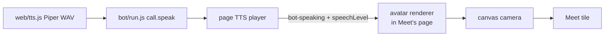

# Spec: A face for the bot that talks when it speaks

## Design

### What already exists (no new plumbing)

The call library (`@vibeconferencing/calls` 0.1.0-alpha.3, MIT) already
does most of the work inside Meet's page:

- Its init script overrides `getUserMedia`; a video request gets a **canvas
  camera** (`canvas.captureStream`, Meet's requested size, default
  1280×720 at 30 fps), drawn every frame by a pluggable renderer:
  `window.__vibeconfMedia.setCameraRenderer(factory)`, where
  `factory(surface)` returns `{ render() }` drawing on `surface.ctx`.
  Without a renderer the canvas is black. Setting a renderer also updates
  cameras that already exist (`inject/page-inject.js` 20–135, 477–523).
- Its TTS player emits `bot-speaking {speaking: true|false}` in the page
  and exposes `window.__vibeconfMedia.speechLevel()`, the live loudness
  (0..1) of the bot's **own** speech from an analyser on the TTS output
  (`page-inject.js` 179–206, 405–458).
- The bot never turns the camera on today; Meet's state at join is its
  pre-join default. The library's `call.camera.setOn(true)` toggles it.

So the face is **one renderer script injected into the page** after join,
plus turning the camera on. No change to the stdin/stdout protocol, the
server's speech queue or the TTS.

### The renderer

- `bot/avatar/renderer.js`: a self-contained function source, injected by
  `bot/run.js` with `call._inner.page.evaluate(...)` (the same
  private-field shortcut `bot/run.js:89` already uses, marked
  `shortcut:` until the library exposes it). It receives the portrait as
  a `data:image/webp;base64,…` string and the portrait's anchors, decodes
  it once, and calls `setCameraRenderer`.
- **Frame:** Factory dark background; the portrait scaled to ~60 % of the
  frame height, centred; a name strip "RFactory Bot (AI)" and an **"AI"
  badge** drawn on the canvas, always visible.
- **Talking:** a mouth overlay at the portrait's mouth anchor opens with
  the smoothed `speechLevel()`; a soft glow ring around the portrait
  follows the same level; a 1–2 % scale bob.
- **Idle:** mouth closed, no glow, a blink (eyelid overlay at the eye
  anchors) every 3–6 s at random.
- **State, a pure function** `frameState(now, speaking, level, prev)` →
  `{ mouth: 0..1, glow: 0..1, blink: 0..1 }` in
  `bot/avatar/state.js` (shared by the renderer and its tests):
  - talking only while `speaking` is true **and** level is above 0.02;
  - the mouth closes within 150 ms when level drops; when `speaking`
    turns false the glow fades out over 300 ms (covers the gap between
    sentences without flicker);
  - **never frozen open:** if no `bot-speaking` event and no level change
    arrive for 1 s, the state is idle; when the page or call goes away the
    renderer goes with it.
- **Anchors:** `bot/avatars/manifest.json` lists each portrait id with its
  file, SHA-256 and `mouth {x, y, w}`, `eyes [{x, y, w}, {x, y, w}]` in
  portrait pixels (256×256), measured by hand. Only portraits with
  anchors can be chosen.
- **Cost:** the renderer draws a cached, pre-scaled portrait plus two
  small overlays per frame; target ≤ 0.3 extra CPU core for Chrome over a
  call without the camera, measured in the feasibility check. If it is
  higher, the renderer draws at 15 fps by skipping frames.

### Turning it on

- Scope file `avatar: "<id>"` (one of the manifest ids). No `avatar`
  → no camera, exactly as today.
- `loadScope` validates the id against the manifest.
- `web/call.js` passes the id to the bot in an environment variable
  (`RFACTORY_AVATAR`); `bot/run.js` reads the portrait from
  `bot/avatars/<id>.webp`, checks its SHA-256 against the manifest, and
  after join (in `afterJoin`, after the chat line): injects the renderer,
  then `call.camera.setOn(true)`.
- **Fails safe:** any error (bad hash, inject failure, `setOn` throwing,
  Meet refusing the camera) is logged as `avatar failed: <reason>` and the
  bot carries on without a camera. Nothing in the join, speech, stop or
  interrupt paths waits on the avatar.

### The portraits in the repository

- `bot/avatars/{f,m}01–20.webp`, the 40 OmegaStar files **unchanged**,
  fetched at commit `8304f225fc2f88f9baef6de622a0d229666e09f9` of
  `itsfutsy/OmegaStar` (`src/assets/avatars/`), each pinned by SHA-256
  in `manifest.json`. A test recomputes every hash.
- `bot/avatars/NOTICE.md`: "Portraits from OmegaStar,
  https://github.com/itsfutsy/OmegaStar, commit 8304f22…, Copyright (C)
  2026 Abram Industries Pty Ltd, licensed under the GNU AGPL v3.0, without
  any warranty (see LICENSE). Files are unmodified." If any file is ever
  converted or cropped, the notice says what changed and when.
- Built into the image with the rest of `bot/`; nothing is fetched at
  runtime.

### Licence (owner decision 2: whole repository AGPL-3.0)

- `LICENSE` at the root: the verbatim GNU AGPL v3 text.
- `"license": "AGPL-3.0-only"` in `bot/`, `core/`, `web/` and `spike/`
  `package.json` (OmegaStar names v3.0 only; "-or-later" would add
  terms the owner did not choose).
- `NOTICE.md` at the root listing third-party parts: the portraits
  (above); `@vibeconferencing/calls` MIT; `playwright-core` Apache-2.0;
  Piper GPL-3.0 (separate process) and the LJSpeech voice (public domain);
  Google Chrome (proprietary, installed in the image, not distributed in
  the repository); core's npm dependencies (MIT, ISC, BSD, Apache-2.0).
- A "Licence" section in `README.md` pointing to both.
- Dependencies checked: every lockfile licence is MIT, ISC, BSD-2/3 or
  Apache-2.0, all compatible with AGPL-3.0.

### Source offer to every user (AGPL §13)

- **The image records its commit:** `deploy/pod.sh` builds with
  `--build-arg RFACTORY_COMMIT=$(git rev-parse HEAD)` and **refuses to
  build from a dirty tree or a commit not on the remote**, so the offered
  source is exactly what runs.
- **Page:** a footer on the RFactory page, "RFactory is free software
  (AGPL-3.0). Source: <repo>/tree/<commit>", from the build argument.
- **Call:** the bot's chat line after join gains the same source link, so
  Meet participants who never open the page get the offer:
  "RFactory Bot (AI) is listening; say 'RFactory' and a question. Source
  (AGPL-3.0): <link>".

### AI disclosure (unchanged and added)

The bot's name "RFactory Bot (AI)", its chat line and listening
announcement stay; the face adds the "AI" badge and name strip on every
frame. The portraits are illustrations, never photographs.

### Feasibility check (owner decision 4) before anything else is built

With the owner's OK and a Meet link, on p620, a short script in `spike/`
(Chrome, as `spike/RESULTS.md:47` requires): join, inject a minimal
renderer (portrait + "AI" badge + a mouth driven by `speechLevel()`),
`call.camera.setOn(true)`, play one TTS clip. Pass when the owner sees the
portrait as the bot's tile, the mouth moves with the clip and stops after
it, and Chrome's extra CPU is recorded. **If it fails:** stop; the intent
returns to the owner to be reframed (for example the face on the RFactory
page only).

## Alternatives rejected

- **Driving the face from the server or bot process** (sending loudness
  over stdin/stdout): adds protocol and timing drift; the page already
  has the exact audio level.
- **A pre-rendered video loop as a fake camera file**
  (`--use-file-for-fake-video-capture`): cannot follow the speech, and the
  library's `getUserMedia` override would bypass it anyway.
- **Real lip-sync from phonemes:** more work, not needed for "is it
  speaking"; a follow-up if wanted.
- **Licensing only the portraits AGPL:** the owner chose the whole
  repository (decision 2).

## Risks

- **Meet may not show the canvas camera** or may join with the camera
  off: the feasibility check decides; the bot already joins and speaks
  without it.
- **Private-field use** (`call._inner.page`) of an alpha library: pinned
  version; marked `shortcut:`; replaced when the library exposes the page
  or a renderer option.
- **CPU:** a 1280×720 canvas plus Meet's encoder under Xvfb; measured
  first, 15 fps fallback.
- **Portrait provenance:** accepted by the owner (intent decision 1); if a
  rights claim is raised, the portraits are replaced with cleared art.
- **Source offer drift:** handled by building only from a clean, pushed
  commit.

## Verification

1. Unit tests (no network):
   - `frameState`: talking only with `speaking` and level > 0.02; mouth
     closes within 150 ms of silence; glow fades over 300 ms after
     `speaking: false`; idle after 1 s with no events even if the last
     level was high; blinks only when idle.
   - manifest: 40 ids, every file's SHA-256 matches, anchors inside
     256×256; `loadScope` refuses an unknown `avatar`.
   - `bot/run.js` with a fake call: with `RFACTORY_AVATAR` set, injects the
     renderer after the chat line and calls `camera.setOn(true)`; a bad
     hash, an inject error or `setOn` throwing → logged, no throw, speech
     still works; without `RFACTORY_AVATAR` the camera is never touched.
   - renderer in headless Chrome (bot's `playwright-core`, `RF_TEST_CHROME`;
     fails, not skips, with `RFACTORY_REQUIRE_BROWSER=1`): with a fake
     `__vibeconfMedia`, the mouth region's pixels differ between level 0
     and 0.8; the "AI" badge pixels are present in every frame.
   - licence: `LICENSE` exists and is the AGPL-3.0 text; every
     `package.json` says `AGPL-3.0-only`; `NOTICE.md` and
     `bot/avatars/NOTICE.md` exist; the page footer and chat line carry
     the source link.
   - `pod.sh`: refuses a dirty tree or an unpushed commit (shellcheck and
     a dry-run test).
2. **Live on p620** (owner's OK): in a Meet, the bot's tile shows the
   chosen face with the "AI" badge; it talks while the bot answers and
   rests between answers; "RFactory, leave" mid-answer leaves without a
   frozen face; with `avatar` removed from the scope the bot joins as
   before with no camera; the chat line shows the source link.
