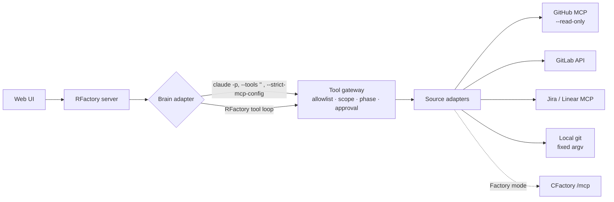

# Spec: Standalone mode, with a choice of source and brain

This spec designs the parts that standalone mode adds:

- status sources, and the scopes built from them
- brains
- the tool gateway that both use

It depends on #1's call bot and web app, which are specced separately. It
reuses #1's approval queue for writes, which arrives in #1's Phase 3.

## Design

### Shape



- **The tool gateway** is part of the RFactory server, and it is the only
  thing a brain can call. It exposes one fixed set of RFactory tools, not
  the upstream tools.
  - `standup_snapshot(scope)`
  - `list_items(scope, state?)`
  - `get_item(scope, id)`
  - `item_activity(scope, id)`
  - and from #1's Phase 3, `propose_change(scope, action, args)`

  The gateway checks scope, phase and allowlist when each tool runs, not
  only when the tool list is built. Every read result carries
  `fetched_at`. Untrusted text (issue bodies, comments, commit messages) is
  returned in a `content` field marked untrusted, and is never treated as
  an instruction to the gateway.
- **The brain never sees upstream tools or credentials.** Upstream MCP
  servers are clients of the gateway, not of the brain.

### Source adapters

Each adapter maps its source onto one item model:

```text
{ id, title, url, state: done|in_progress|blocked|left|unknown,
  source_state, assignees, updated_at, evidence[] }
```

`source_state` is the source's own state text, kept so the bot can show
what it didn't recognise. `evidence` lists linked PRs or MRs, CI status and
commits.

| Source | How | Default state mapping (each scope can override it) | Credential |
|---|---|---|---|
| GitHub | `github-mcp-server` with `--read-only` and `--toolsets issues,pull_requests,repos,actions,projects`, run as a gateway child | see the precedence rules below. Done = closed issue or merged PR. In progress = a linked open PR, or a Projects board status the scope maps to in-progress. An assignee alone is **not** in progress. | fine-grained PAT, read-only, one repo or org |
| GitLab *(provisional, S3)* | REST API from the adapter, using only `GET` | same rules, with MRs and pipelines | token with `read_api` scope |
| Jira *(provisional, S4)* | Atlassian's remote MCP server, read tools only | status category Done / In Progress / To Do. A configured status name, or a flagged issue, means blocked. | API token. It can't be made read-only, so the gateway exposes no write path for it until Phase 3. |
| Linear *(provisional, S4)* | Linear's MCP server, read tools only | state type completed / started / unstarted or backlog; a `Blocked` label means blocked | API key, same rule as Jira |
| Local git *(provisional, S5)* | adapter runs `git` with a fixed argv and no shell | Each item is a branch other than the default branch. The default branch is the remote `HEAD`. A branch merged into it → done. A branch with commits in the last `active_days` (scope setting, default 7) → in_progress. Otherwise → left. The standup says "no tracker data" and labels activity as *inferred*. | none. RFactory clones the repo itself. |
| Factory (#1) | CFactory `/mcp`, read key | as in #1 | CFactory `read` key |

The Jira row is built by #59 with the direct REST API; see `spec/2026-11-27-59-jira-confluence.md`. S4 keeps Linear and the "repo plus tracker" scope.

- **Precedence**, applied in order, first match wins, for every tracker
  source:
  1. A board status that the scope maps explicitly.
  2. Closed or merged → `done`.
  3. A `blocked` label or flag, or failing required checks on the linked
     open PR → `blocked`.
  4. A linked open PR or MR → `in_progress`.
  5. Open → `left`.

  A board status that has no mapping goes to `unknown`, and it doesn't
  fall through to the later rules. Each item records which rule set its
  state, and whether that state was **observed** (from tracker or board
  status) or **inferred** (from PR, CI or commit activity).
- **Combined scopes:** one repo source plus at most one tracker source. The
  tracker decides an item's state. The repo only adds evidence (PRs, CI,
  commits). When they disagree, for example a closed issue with failing CI
  on its PR, the item is `done`, and the disagreement is listed as
  evidence. The bot never re-decides the state.
- **Local clones:**
  - path `/var/lib/rfactory/repos/<scope>`
  - an admin adds them by URL
  - fetched before each snapshot, never pushed
  - the clone credential is read-only (a deploy key or token)
- **Unknown states** map to `unknown` and are always listed. They are
  never dropped or guessed.

### Brains

One interface: `turn(scope, conversation) → stream of { text | tool_call | done }`.

| Brain | Adapter | How the limits are enforced | v1 |
|---|---|---|---|
| Claude Code CLI | runs `claude -p --restricted --tools "" --strict-mcp-config --mcp-config <gateway only> --allowedTools "mcp__rfactory__*" --no-session-persistence --output-format stream-json` with a dedicated `HOME` that holds only the subscription login, a scrubbed environment (no `ANTHROPIC_*` or proxy variables), and an empty working directory | `--tools ""` removes every built-in tool. `--restricted` ignores user, project and local settings files, so their hooks are not loaded. `--strict-mcp-config` loads only the gateway. `--bare` is not used, because it refuses the subscription login. A pinned CLI version, plus a tool-inventory check at start-up (below), is required; if that check fails, the brain is not offered. | yes, if the inventory check passes |
| OpenAI-compatible | RFactory's own tool loop, using the `openai` JS SDK with `baseURL`; only gateway tools are sent | the model can only call the tools we pass in | yes |
| Ollama | the same adapter, pointed at Ollama's `/v1` endpoint | same | yes, read-only. A separate write qualification will be defined in S6. |
| Codex CLI | — | its CLI (0.169) has no way to turn off its shell tool | **not offered** (fail closed) until a check proves the shell can be turned off. Then it gets an adapter like Claude's. |

- **Destination approval.** Each brain config is `{ kind, endpoint, model,
  destination: third-party | rfactory-host | other-machine }`.
  - An admin approves a config for a scope. The approval stores a hash of
    the **effective** destination, which the adapter resolves when it
    starts:
    - OpenAI-compatible and Ollama: the final base URL after redirects,
      and the model. The SDK is built with that URL and with redirects to
      another host turned off.
    - Claude Code: the CLI version, plus a check that the scrubbed
      environment and the dedicated `HOME` set no base-URL, proxy or
      provider override.
  - The adapter computes the hash and compares it **before the first
    request** of every turn. Any difference disables the brain for the
    scope until it is approved again.
  - The web UI shows the destination label on every call.
- **Model input boundary.** Everything a brain receives goes through one
  function, `toModel()`, in the gateway. That covers tool results,
  upstream errors and transcript text. `toModel()` removes every stored
  secret value and any credential-shaped string. The same function feeds
  the stored transcript and the logs, so they can't drift apart.
  - Child MCP processes get their credentials through their environment
    only. Their stderr is not sent to the brain.
  - Brain authentication (an API key, or the CLI's login) stays in the
    adapter's process or the dedicated `HOME`, never in prompts.
- **What the brain's text can do.** It is the brain's free text that gets
  spoken. Status facts in it must come from tool results. The adapter
  checks every item ID and number in a spoken status answer against the
  last `standup_snapshot`, and says "I couldn't confirm that" for anything
  that isn't there.

### Scopes, roles, credentials

- **Scope config**, stored in the database:
  `{ name, sources[], brain, writes_enabled: false, mapping overrides }`.
  There is also a deployment-wide switch, `RFACTORY_WRITES=off` by default.
- **The write rule.** The gateway runs a write only if **all** of these are
  true:
  1. The deployment switch is on.
  2. The scope's `writes_enabled` is on. Only an admin can set it, and
     only once #1's Phase 3 is shipped.
  3. The action is on that source's write allowlist.
  4. The arguments are byte-for-byte the ones that were approved (a hash of
     `scope + action + args`).
  5. The approval has not been used before. Each approval works once and
     expires after 10 minutes.
  6. The approver holds approval rights for the scope **and** passes the
     source authority check below.

  Never-allowed actions aren't on any allowlist, and they are rejected by
  name as a second check:
  - merge, delete, force-push
  - changing settings, permissions, members, webhooks or integrations
  - any credential operation

  This covers every source, including Jira, Linear and local git.
- **Source authority check.** In S6 an approver links their own source
  identity (GitHub or GitLab OAuth). Before a write runs, the gateway asks
  the source whether that identity can perform that exact action. For
  example, GitHub's collaborator permission must allow editing issues in
  that repo.
  - If the check is not possible for a source, there are no writes for it.
  - Until S6 there are no writes at all, so v1 needs no mapping.
- **v1 roles, per scope:**

  | Role | May |
  |---|---|
  | admin | connect sources, approve brains, enable writes |
  | approver | approve the changes in the queue |
  | member | start a bot, view calls and status |

  Read access to a scope's content follows these roles. An approver must
  also pass the source authority check (above) for each write.
- **Credentials:**
  - stored encrypted in the database, with a key from the deployment's
    secret store (sops-nix or agenix on p620, a Kubernetes secret in the
    cluster)
  - decrypted only inside the gateway process
  - never passed to a brain, and never written to a transcript or a log
  - logs go through a redactor that knows every stored secret

### Slices

| # | Slice | Depends on |
|---|---|---|
| S1 | GitHub source, OpenAI-compatible and Ollama brains, read-only text standup in the web UI | #1 Phase 1a (web app) |
| S2 | The Claude Code CLI as a standalone brain, and voice standups in the call | #1 Phase 1b |
| S3 | GitLab | S1 |
| S4 | Jira and Linear, including a repo plus tracker scope | S1 |
| S5 | Local git | S1 |
| S6 | Writes through `propose_change` for GitHub and GitLab issues, comments, labels and board moves | #1 Phase 3 |
| S7 | Codex CLI, only if its shell can be turned off | — |

Each slice gets its own plan. **This spec is approved for S1 and for the
shared rules:**

- the gateway, the write rule, destination approval, the model input
  boundary
- fail-closed brains, and the precedence rules

Rows marked *provisional* (GitLab, Jira, Linear, local git) and the
details of S3–S7 are confirmed or changed in each slice's own plan. Any
change to the shared rules needs an updated spec.

## Alternatives rejected

- **Giving brains the upstream MCP servers directly:** no central place
  enforces scope, phase or approval. The GitHub MCP server's write tools
  would be one flag away, and the brain would hold the credential.
- **One generic "run any MCP tool" pass-through in the gateway:**
  allowlisting upstream tool names breaks whenever an upstream renames a
  tool, and the brain still sees source-specific shapes. A fixed RFactory
  tool set is smaller and stable.
- **Writing our own GitHub client:** `github-mcp-server` already has a
  read-only mode and the toolsets we need. GitLab gets a small REST
  adapter, because only `GET` is needed.
- **LangChain or a similar agent framework for the tool loop:** a
  function-calling loop is about 100 lines with the `openai` SDK, and it
  works for Ollama and any compatible endpoint.
- **Codex in a locked-down container with its shell still on:** this
  breaks the intent's "no shell" constraint, and a fail-closed rule means
  not offering it at all.
- **Letting an RFactory approver role authorise writes on its own:** it
  doesn't prove the person may make that change in the source, which
  breaks the intent. The source authority check is required instead.

## Risks

- **Upstream MCP servers change** (GitHub, Atlassian, Linear). We pin
  versions, and the adapters have contract tests against recorded
  responses.
- **Ollama tool-calling quality.** Small models may call tools wrongly or
  make up status. Spoken status facts are checked against the last
  snapshot (see "What the brain's text can do"), so an invented item is
  replaced with "I couldn't confirm that". Ollama stays read-only, and S6
  defines a separate write qualification covering proposal arguments,
  scope and malicious source content.
- **Tokens that can't be made read-only** (Jira, Linear). Only RFactory's
  gateway stands between the brain and a write. The gateway is therefore
  the most-tested part, and these sources have no write tools at all
  until S6.
- **Prompt injection through issue text.** A malicious comment can try to
  steer the brain. The gateway checks its rules no matter what the brain
  asks, and every write goes through human approval with the exact
  arguments shown.
- **Data leaving the server.** Source content goes to hosted brains. The
  destination label and the re-approval on any endpoint change are the
  control.

## Verification

**Gateway and the write rule** (no network):

- Each RFactory tool works against recorded upstream responses.
- Scope:
  - checked on every call
  - a request that names an item, repo or ID from another scope is
    rejected
  - so is an ID embedded in arguments
- Writes are rejected:
  - with the deployment switch off and the scope on
  - with the scope off and the deployment switch on
  - when the approver lacks scope rights
  - when the source authority check fails
  - with changed arguments
  - with a replayed or expired approval
- Every never-allowed action (merge, delete, force-push, settings,
  permissions, members, webhooks, integrations, credentials) is rejected by
  name for every source, even if it were wrongly added to an allowlist.
- **Live tool inventory:** at start-up, the gateway lists each upstream
  server's tools. GitHub must run with `--read-only`, so no write tool is
  present, and start-up fails if one is.

**Brain isolation:**

- **Claude Code tool inventory.** At adapter start-up, and in CI with the
  pinned CLI version, a probe turn runs with the exact launch command. The
  stream-json `init` event must list **only** `mcp__rfactory__*` tools.
  - If any other tool is listed, the brain is not offered.
  - A model refusing a prompt is **not** accepted as evidence.
  - The probe also checks that no hooks or settings files from the
    dedicated `HOME` are loaded.
- **OpenAI-compatible:** a model that asks for an unknown tool gets an
  error result, and nothing runs.
- **Destination:** each case disables the brain before the first request
  is sent:
  - changing the endpoint
  - a redirect to another host
  - a base-URL variable in the environment

  A test server records that it received nothing.

**Model input boundary:**

- A stored token is planted in a tool result, an upstream error, a child
  MCP server's stderr and the transcript.
- It must be absent from the actual outgoing model request (captured by a
  test endpoint), from the stored transcript and from the logs.

**Untrusted content:**

- Fixtures with instructions hidden in an issue comment, a commit message,
  a diff and a spoken caption. They try to grant permissions, change the
  scope, approve an action or change the destination.
- None of them changes gateway state, and every write stays queued for
  human approval.

**State mapping:**

- Fixtures for each precedence rule, for an assigned-but-idle issue
  (`left`), an issue that is both blocked and assigned (`blocked`), and a
  closed issue with failing CI (`done`, with the disagreement listed as
  evidence).
- Also fixtures for an unmapped board status (`unknown`), and the
  observed/inferred flag.

**Independence:**

- The standalone end-to-end test runs with all Factory services
  unreachable (CFactory, PFactory, AIFactory and TFactory blocked at the
  network layer).

**Ollama (read-only):**

- 20 recorded standup prompts per candidate model.
- After the snapshot check, no invented item may reach speech. The raw
  accuracy is recorded for the model's description.

**End to end (S1):**

- A real GitHub repo with fixture issues and PRs gives a standup in the
  web UI that matches the repo, with data age shown and unknown states
  listed.
