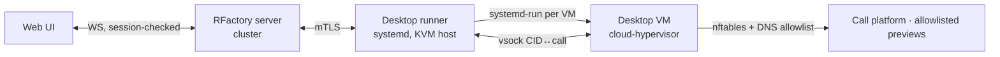

# Spec: Agent workspace, a disposable desktop per call

## Design

### Answers to the intent's open questions

- **Isolation boundary:** VM-level for any desktop the agent can drive. A
  container is allowed only for a call-only bot that the agent can't
  drive, which is #1's Phase 0 shape.
- **Who approves:** the per-scope **approver** role from #2. That role
  hands over control, approves shares, and approves single actions.
  Watching the live desktop is open to scope **members**.
- **App control in v1:** web apps only, through Playwright in the guest.
  Native apps and terminals are a later slice.
- **Project copy:** v1 only opens preview or staging URLs that already
  exist and are on the scope's allowlist. It doesn't build previews.
- **Sizing:**
  - Each desktop gets 2 vCPU, 3 GiB RAM and a 4 GiB disk, plus 0.5 GiB
    set aside for VM overhead.
  - p620 starts with at most 3 desktops. The **pre-booted spare counts
    toward the 3.**
  - The first plan measures these numbers, and they are set in config.
- **Window share** depends on the share check (D5) in #1's Phase 0. The
  share part of this spec is built only once D5 passes. If D5 fails, this
  spec gets an update (the library's loopback design) and is approved
  again before any share work. The rest of the spec doesn't depend on
  sharing.

### Feasibility gate (first plan step)

Four transport and isolation facts are assumed here, and the first plan's
step 1 must prove them before anything else is built:

1. A disposable VM can be created and destroyed at runtime without
   rebuilding the host. It uses `microvm.nix` with **cloud-hypervisor**,
   in the same way as `nixarchy vm`
   (`nixarchy-microvm/AGENTS.md`: state under
   `$XDG_STATE_HOME/nixarchy/microvm/<name>/`, no root, no rebuild).
2. A vsock to the guest carries a length-prefixed JSON channel, and VNC
   gets through it. In the guest, `x11vnc` listens on `127.0.0.1:5900`
   and `socat VSOCK-LISTEN:5900,fork TCP:127.0.0.1:5900` bridges it.
3. Per-tap nftables rules block everything described under **Network**,
   for IPv4 and IPv6, including guest-to-guest traffic.
4. Inside the VM, Meet still passes #1's Phase 0 pass criteria.

If any of these fails, the plan stops and this spec is updated.

### Shape



- **The desktop runner** is the only component that creates or destroys
  desktops. It runs on the KVM host: p620, or a self-managed cloud VM with
  KVM.
  - The server talks to it over mTLS with `create`, `destroy`, `list` and
    `heartbeat`.
  - It assigns each VM a vsock CID and keeps a map from CID to `call_id`
    and scope. Every message arriving on a vsock is tagged from that map,
    never from anything the guest sends.
- **The guest** is one read-only NixOS image built from this repo's flake.
  It runs:
  - Xvfb with openbox
  - Google Chrome for the call, the call worker, and Playwright with a
    separate Chrome for control and share
  - `x11vnc` on localhost, with a `socat` vsock bridge

  It has no SSH and no secrets in the image.
- **The control channel** is three vsock ports, and the host listens on
  no others:
  - **control:** commands to the call worker, and events back
  - **vnc:** the live view
  - **heartbeat:** guest liveness

  Messages are length-prefixed JSON with a 64 KiB limit and are checked
  against a schema. Unknown or malformed messages are dropped and logged.
  The guest can't name a call, a scope or a desktop. The runner adds those
  from the CID map.

### Network

The rules are per tap and apply to IPv4 and IPv6. Protected ranges are
checked **first**, so no exception can reopen them.

1. **Drop:**
   - RFC1918, CGNAT (100.64/10) and link-local
   - IPv6 ULA and link-local
   - `169.254.169.254`
   - the host's own addresses
   - the cluster's pod and service ranges
   - the Factory hosts
   - every other desktop's address
2. **Anti-spoofing:** only the guest's assigned source address is accepted
   on its tap, and nothing is forwarded between taps.
3. **DNS:** the guest may only use the runner's resolver. That resolver
   (dnsmasq with `nftset=`) answers only names on the platform allowlist
   and the scope's preview allowlist, and it adds the addresses it
   resolves to a per-VM nft set. TCP and UDP to that set are allowed.
4. **Media:**
   - UDP and TCP to the call platform's **published media IP ranges** are
     allowed. These are Google Meet's, Zoom's, Microsoft Teams' and
     Slack's published network lists.
   - The ranges are pinned in the repo and refreshed by a scheduled job,
     which opens a PR for review.
   - WebRTC media goes to these addresses through ICE, not through DNS
     names.
5. **Everything else is dropped**, with a rate-limited log of each drop.
6. **Private-network previews:** a preview URL on a private network is
   allowed only as an admin-approved `host:port` for one scope. It is
   added after the protected drops, but it can't fall inside the host, the
   cluster or the Factory ranges. Such a preview has to be reachable on
   another address.

The guest therefore reaches only the call platform and approved preview
hosts, as the intent says.

### Lifecycle and disposal

- **Create:** each VM starts from the read-only image with an empty
  overlay disk on tmpfs. It runs as its own transient unit:

  ```text
  systemd-run --unit=rfactory-vm-<id> \
    -p RuntimeMaxSec=3h -p BindsTo=rfactory-runner.service -p PartOf=rfactory-runner.service
  ```

  - systemd enforces the 3 h limit even if the runner is down.
  - The VM dies when the runner dies, so it fails closed.
  - The overlay is on tmpfs, so it is gone whenever the unit stops.
  - One pre-booted spare is allowed, and it counts toward the limit. A VM
    is bound to one `call_id` once it is claimed.
- **Destroy.** The VM is destroyed when any of these happens:
  - the call ends normally, as reported by the call worker
  - the call worker sends no heartbeat over vsock for 30 s, which counts
    as controller loss
  - the server sends no heartbeat for 60 s
  - it has been idle for 10 min, meaning no speech, no share and no tool
    call
  - `RuntimeMaxSec` is reached
  - the runner stops
- **Recovery:** when the runner starts, its reconcile loop stops every
  `rfactory-vm-*` unit and deletes leftover state. A desktop does not
  survive a runner restart, even if its call is still live; the call
  continues voice-only, or the user rejoins.
- **Cleanup failures** are retried 3 times with backoff. After that they
  raise an alert in the web UI's admin view and in the logs, and the
  runner refuses new `create` calls until the failure is cleared.
- **Capacity:** with 3 VMs running (spare included), `create` returns
  `capacity` at once, and the call is **refused** with a clear message, as
  the intent requires. The user may then explicitly start a voice-only bot
  instead, which is #1's container bot with no desktop. Nothing changes
  silently.
- **Per-VM limits:**
  - fixed CPU and RAM
  - a 4 GiB tmpfs overlay
  - a 20 Mbit/s `tc` rate limit on the tap
  - a 1 GiB per-call egress quota, after which the tap is dropped and the
    call is ended

### Driving apps

- **Gateway tools** (the gateway from #2):
  - `desktop_open(url)`
  - `desktop_click(target)`
  - `desktop_type(target, text)`
  - `desktop_scroll(dy)`
  - `desktop_screenshot()`

  They run on the guest's control Chrome, which is separate from the call
  Chrome.
- **Handover:** an approver grants a control session in the web UI:

  ```text
  { scope, call_id, desktop_id, actions[], hosts[], until }
  ```

  `until` can be at most 30 min away. **On every tool call** the gateway
  checks that:

  1. the session exists and has not been revoked
  2. `now < until`
  3. `scope`, `call_id` and `desktop_id` match the call that is running
  4. the tool is in `actions`
  5. for navigation, the target origin is in `hosts`

  A call that fails the session checks but is otherwise allowed for the
  scope goes to the **per-action approval queue**, as in #1 and #2. It
  shows in the web UI and runs only once approved. It isn't silently
  rejected.
- **Browser boundary.** `hosts` governs **all requests** of the control
  context, not just top-level navigation.
  - `context.route('**/*')` aborts any request whose origin isn't in
    `hosts`. This catches redirect chains, meta refresh, JS `location`,
    form posts, fetch, and click- or type-triggered navigation.
  - The context is created with `serviceWorkers: 'block'`.
  - Popups and new pages share the context and its route handler. Any
    page that isn't in the context is closed when it opens.
  - The network-level allowlist is a second boundary under this one.
- **Revoke.**
  1. The gateway marks the session revoked at once, and later tool calls
     fail.
  2. The runner sends `cancel` on the control port. The guest closes the
     control context and stops any action in flight.
  3. If the guest doesn't confirm within 2 s, the runner destroys the VM.
     That is the fail-closed path.
- **No secrets.**
  - The guest gets no credential: no source, Factory or call-platform
    login, and no cookies. The two exceptions are an admin-approved
    profile and an approved preview login (below).
  - `desktop_type` also refuses values that match a stored credential, as
    extra protection, not the guarantee.
  - A preview login is filled in by the runner's own
    `desktop_login(profile)`, never by the brain.
- **Untrusted content:** screenshots, page text and titles go to the brain
  as untrusted `content`, as in #2. Nothing on the screen or in speech can
  change a session, a share, an allowlist or an approval.
- **Pending actions are shown:** the web UI shows the active handover with
  a countdown, the action running now, and the queued actions waiting for
  approval, all live.

### Share

- **The share window:**
  - The share window is a page in the control Chrome, opened in app mode.
  - Its title is fixed at `RFactory share <nonce>`, where the nonce is
    random for each share.
  - An init script locks `document.title`, so the page can't change it.
- **Launch flag:** the call Chrome is launched with
  `--auto-select-desktop-capture-source=RFactory share <nonce>` for that
  share.
- **Starting a share:**
  - The brain can only call `propose_share(url)`.
  - An approver's click starts it.
  - The URL must be in `hosts`.
- **Checking the capture before it reaches the call** (fail closed): the
  call worker's `getDisplayMedia` hook checks the returned track.
  - It requires `getSettings().displaySurface === 'window'` and a track
    `label` that contains the nonce.
  - If either check fails, the track is stopped before it is handed to
    Meet, and the share is reported as failed.
  - A whole-screen source is therefore never sent, even if Chrome were to
    pick one.
- **Stop:**
  - The web UI shows a "Sharing: <url>" banner with **Stop**.
  - Stop calls `stopShare` and also closes the share window. Closing the
    window ends the capture, so the share ends even if `stopShare` or the
    control channel fails.
  - If the control channel is down for 5 s during a share, the runner
    destroys the VM.

### Persistent profiles

- **The record:**

  ```text
  { scope, purpose, approved_by, created_at, retention_days (default 30) }
  ```

  - Only an admin creates a profile.
  - The approving admin and the scope's admins can list and delete it.
  - It is never attached to another scope, and to at most one desktop at a
    time, under a lock.
- **Storage:** a LUKS-encrypted disk image on the runner. The key is kept
  by the runner, loaded from sops-nix or agenix.
  - It is sent to the guest over the control vsock at boot, and the guest
    unlocks it with dm-crypt.
  - The **plaintext exists only in the guest's memory**. The host only
    ever sees ciphertext.
  - A crash leaves only ciphertext on the host.
- **Deletion:**
  - Deleting a profile, or reaching its retention date, while it is
    attached destroys that desktop first and then deletes the image.
  - A profile's sessions count as credentials under the no-secrets rule.

### Live view

- VNC over vsock goes through the runner to the server, then to noVNC as a
  WebSocket.
- **Admission:**
  - The server checks the user's session and their scope membership
    before accepting the WebSocket.
  - It checks again every 5 s, and closes the stream when membership or
    the session ends.
  - A stream is bound to one `desktop_id`.
- **It is view-only.** Pointer and keyboard input from the browser are
  dropped by the server.

## Alternatives rejected

- **Pods for driven desktops:** a container boundary is weaker than the
  intent needs once the agent browses and types. Pods are used only for
  call-only bots.
- **KubeVirt:** it adds a second control plane, and a host runner with
  `microvm.nix` is enough.
- **Hosted desktop or VM services:** the intent requires self-hosting.
- **Open public egress with URL checks only in the tool layer:** this
  breaks the intent's network constraint and can't contain a compromised
  guest.
- **An HTTP proxy domain allowlist on its own:** it can't carry WebRTC
  UDP. DNS-driven nft sets plus published media ranges can.
- **Choosing the share window by title alone:** a title can match the
  wrong window. The track-label and `displaySurface` checks make it fail
  closed.
- **Decrypting profiles on the host:** that leaves plaintext on the host.
  LUKS inside the guest keeps it in guest memory only.
- **Screenshot-and-click computer use in v1:** Playwright with an origin
  allowlist is safer and more reliable for web apps.
- **Wayland in the guest:** X11 is simpler for title-based capture
  selection and VNC.

## Risks

- **The feasibility gate fails** (dynamic microVMs, vsock VNC, nftables,
  or Meet in a VM). The plan stops there and the spec is revisited.
- **D5 fails:** the share part is not built until a loopback spec is
  approved.
- **Media IP ranges drift:** a platform changes its ranges and calls lose
  media. The scheduled refresh PR plus a connectivity check before each
  call catch this. The failure mode is no audio, not open egress.
- **No KVM on a cloud VM:** the runner refuses `create`, and only
  voice-only bots run there.
- **Capacity on p620:** 3 × 3.5 GiB sits next to the Factories. The limit
  is in config and is measured first.
- **A guest escape** is a hypervisor bug. cloud-hypervisor is pinned and
  updated, the guest holds only ciphertext profiles, and it has no route
  to protected hosts.

## Verification

- **Feasibility gate:** the four facts above, each shown by a scripted
  check on p620 (with the owner's OK).
- **Network, from inside a guest:**
  - TCP and UDP, on IPv4 and IPv6, fail to: p620's LAN, the cluster
    ranges, the Factory hosts, `169.254.169.254`, and another running
    desktop
  - DNS for a name that isn't on the allowlist fails
  - an allowlisted preview works
  - a spoofed source address is dropped
  - a private-preview exception that overlaps a protected range is
    refused when it is configured
- **Control channel:**
  - a probe on any vsock port other than the three fails
  - oversized, malformed and wrong-schema messages are dropped
  - a guest message that claims another `call_id` is tagged with its real
    one
- **Lifecycle:** each test checks with `list`, `systemctl` and the
  filesystem that nothing is left:
  - normal call end
  - call-worker heartbeat loss
  - server heartbeat loss
  - idle expiry
  - `RuntimeMaxSec`, shortened in the test
  - killing the runner, after which the VMs die with it (BindsTo)
  - a runner restart with a live call: the VM is not kept
  - a forced cleanup failure, which is retried and alerted, and which
    blocks `create`
- **Capacity:**
  - a 4th `create`, counting the spare, is refused with `capacity`, and a
    voice-only bot needs an explicit choice
  - two `create` calls at the same time are handled
  - the tmpfs and egress limits are hit and enforced
  - start-up time is measured
  - one call's audio is checked while two others run
- **Handover:**
  - rejected or queued correctly for each of these:
    - no session, an expired session, or a revoked session
    - the wrong scope, call or desktop
    - an action that isn't in `actions`
  - blocked: a redirect chain, meta refresh, JS `location`, a popup to
    another origin, a service worker, a form post and a click that
    navigates elsewhere
  - revoke during an action stops it within 2 s, or destroys the VM
- **Secrets:**
  - the guest holds no credential files or cookies apart from the
    attached profile
  - `desktop_type` with a stored value is refused
  - a preview login never appears in the brain's input or in logs
- **Share:**
  - a share runs only with the approved, nonce-titled window
  - a page that tries to change its title stays fixed
  - with the auto-select flag pointed at the screen, the track check stops
    the track and nothing reaches Meet (checked live by the owner)
  - Stop ends the share even when `stopShare` is made to fail
  - a control channel lost for 5 s destroys the VM
- **Profiles:**
  - a profile can't attach to another scope, and can't attach twice at
    once
  - the host holds only ciphertext, both while attached and after a crash
  - deleting or retention-expiring an attached profile destroys the
    desktop first
- **Live view:** a non-member and a member of another scope are refused.
  Revoking a member closes their open stream within 5 s. Browser input is
  ignored.
- **End to end:** on p620 with the owner's OK:
  1. In a desktop VM, the bot joins a Meet.
  2. An approver hands over control for one allowlisted preview origin.
  3. The agent opens it.
  4. The approver approves a share, and the owner sees only that window.
  5. Stop ends it.
  6. The call ends, and nothing of the VM is left.
