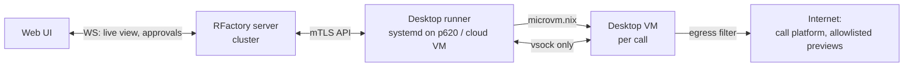

# Spec: Agent workspace, a disposable desktop per call

## Design

### Answers to the intent's open questions

- **Isolation boundary:** VM-level for any desktop the agent can drive.
  - A container (a pod) is allowed only for a call-only bot that has no
    app control. That bot is #1's current Phase 0 shape.
- **Who approves:** the same per-scope **approver** role as #2. Watching
  the live desktop is open to every **member** of the scope.
- **App control in v1:** web apps only, driven through Playwright inside
  the guest.
  - Native apps and terminals are not in v1. They are a later slice.
- **Project copy:** v1 only opens URLs that already exist (preview or
  staging) on the host allowlist. Building a preview inside the desktop is
  out of scope.
- **Sizing:** 2 vCPU, 3 GiB RAM, and 4 GiB disk per desktop. At most 3 run
  at once on p620 to start with. This is measured in the first plan and
  set in config.
- **Window share:** this depends on the result of #1's Phase 0 share check
  (D5).
  - If D5 passes, window sharing works as described below.
  - If it fails, sharing stays off and the library's loopback design
    becomes its own task. Everything else in this spec still ships.

### Shape

- **The desktop runner** is a small service on the KVM host: p620, or a
  self-managed cloud VM that supports nested or bare-metal KVM.
  - It is the only thing that creates or destroys desktops.
  - The RFactory server, which runs in the cluster, talks to it over an
    mTLS API: `create(call_id, scope, profile?)`, `destroy(id)`, `list`,
    and a heartbeat.
  - It reuses the disposable-VM approach of `nixarchy vm` and
    `microvm.nix`: user-level state, no rebuild of the host.
- **The guest** is one NixOS microVM image, built from this repo's flake.
  - It has X11 under Xvfb with a minimal window manager (openbox). Chrome
    picks the window to share by its title, and X11 window titles make
    that reliable.
  - It runs Google Chrome, the call worker (#1's harness, grown up),
    Playwright for web-app control, and `x11vnc` bound to the vsock only.
  - It has no SSH and no secrets in the image.
- **The control channel is vsock.** The guest has no network path to the
  host or to the cluster.
  - Through it travel: call worker commands and events, the VNC stream for
    the live view, and the control-handover state.
  - The runner forwards only these three channels.
- **Network:**
  - The guest's tap interface is filtered on the runner with nftables.
  - Drop rules cover RFC1918, link-local, CGNAT, the host's own
    addresses, the cluster's ranges, and the Factory hosts.
  - Everything else on the public internet is allowed, because call media
    (WebRTC over UDP to the call platform) needs it.
  - A preview URL on a private network is allowed only as an explicit
    `host:port` exception, per scope, approved by an admin.
  - Tool-level allowlists (below) limit what the agent opens, so open
    internet egress does not mean the agent may browse anywhere.

### Lifecycle

- **Create:** when a call starts, the runner boots a fresh VM from the
  read-only image, with an empty overlay disk. It may keep **one**
  pre-booted, unclaimed VM per host to hide boot time. A claimed VM is
  bound to one `call_id` for its whole life.
- **Destroy.** The VM is destroyed when any of these happens:
  - the call ends
  - the call worker crashes
  - no server heartbeat arrives for 60 s
  - it has been idle for 10 min
  - it reaches its maximum lifetime of 3 h, whatever the call state

  When the VM is destroyed, its overlay disk is deleted. On a runner
  restart, a reconcile loop destroys every VM that has no live call.
  Failed cleanup is retried with backoff, and the web UI and logs report
  it.
- **Capacity:** when 3 desktops are already running, `create` fails at
  once with `capacity`. The web UI then says "no desktop available", and
  the call can still go ahead as a voice-only bot.
- **Per-VM limits:** CPU and RAM are fixed by microVM config. Disk is a
  4 GiB overlay. Network is capped with a `tc` rate limit of 20 Mbit/s.

### Persistent profiles

- A profile is named, belongs to one scope, and is created only by an
  admin. An example is a Slack sign-in.
- It is stored on the runner as an age-encrypted image and attached
  read-write only to that scope's desktops. It is detached and re-encrypted
  when the desktop is destroyed.
- It counts as a credential:
  - an admin can list it and delete it
  - it has a retention period, 30 days by default, after which it is
    deleted
  - it is never attached to another scope

### Driving apps

- **Gateway tools**, the same gateway as #2:
  - `desktop_open(url)`
  - `desktop_click(selector | text)`
  - `desktop_type(selector, text)`
  - `desktop_scroll(dy)`
  - `desktop_screenshot()`

  They run through Playwright in the guest, on a browser separate from the
  call browser.
- **Handover:** an approver grants a control session in the web UI:
  `{ actions[], hosts[], until }`.
  - `hosts` is an allowlist of URL origins.
  - `until` is at most 30 minutes away.
  - The gateway rejects every desktop tool outside an active session, and
    rejects any URL outside `hosts`, including after redirects.
    Navigation outside the allowlist is blocked at Playwright's route
    layer.
  - **Revoke** ends the session immediately. The runner tells the guest
    to drop its Playwright context.
- **Typing secrets:** `desktop_type` refuses a value that matches a
  stored credential. An approved preview login is filled in by the runner
  itself, never by the brain, through a `desktop_login(profile)` action
  that only an admin can attach to a scope.
- **Untrusted screen content:** screenshots and page text go to the brain
  as untrusted `content`, as in #2. Nothing on the screen can change a
  session, a share or an allowlist.

### Share

- Only the window titled `RFactory share: <scope> <n>` can be shared.
  Chrome is launched with
  `--auto-select-desktop-capture-source=RFactory share: <scope> <n>`, and
  the share browser sets that title.
- Starting or changing a share needs an approver's click in the web UI.
  The brain can only ask for a share with `propose_share(url)`.
- The web UI always shows a "Sharing: <url>" banner with a **Stop** button.
  Stop calls `stopShare` and closes the share window. Closing the window
  ends the share in Meet even if `stopShare` fails.
- The whole desktop is never shared. No capture source is set up for it.

### Live view

- The VNC stream goes from the guest over vsock to the runner, then to
  the server, then as a WebSocket to noVNC in the web UI.
- It is view-only, and only scope members can see it. Approvers get no
  pointer or keyboard input either; v1 is view-only for people.

## Alternatives rejected

- **Pods for desktops the agent can drive:** a container boundary is
  weaker than the intent's isolation constraint needs once the agent
  browses and types on it. Pods stay only for call-only bots.
- **KubeVirt inside the p620 cluster:** heavy to run, it adds a new
  control plane, and it is not needed when a host-level runner can use
  `microvm.nix` directly.
- **Hosted desktop or VM services:** ruled out by the intent
  (self-hosted).
- **SSH or a network control channel into the guest:** it opens a path
  from guest to host. Vsock gives only the channels we forward.
- **A domain allowlist for all egress through an HTTP proxy:** WebRTC
  media is UDP to the call platform's media servers and can't go through
  an HTTP proxy. We block private ranges at the network layer and limit
  URLs at the tool layer instead.
- **Driving the desktop with screenshot clicks (computer use) in v1:**
  web apps are driven more reliably and more safely through Playwright,
  with an origin allowlist. Native apps are a later slice.
- **Wayland in the guest:** Chrome's auto-select of a window by its title
  and `x11vnc` are both simpler and better tested on X11.

## Risks

- **Phase 0's D5 fails:** window sharing then needs the library's
  loopback. Sharing is gated on D5, and everything else still ships.
- **No KVM on the cloud VM option:** some instance types can't nest KVM.
  On those hosts the runner refuses `create`, and RFactory runs voice-only
  bots there.
- **Open public egress:** a compromised guest can reach the internet. It
  is disposable, holds no secrets, can't reach the host or the cluster,
  and is rate-limited. The agent's own reach is limited by the session
  allowlist.
- **Capacity on p620:** 3 desktops use about 9 GiB of RAM next to the
  Factories. The limit lives in config and the first plan measures it.
- **Meet in a VM:** it may treat the VM's Chrome differently from Phase
  0's container. The first plan repeats the Phase 0 pass criteria inside
  the VM.
- **Profile theft:** a Slack profile is a live session. It is encrypted at
  rest, bound to one scope, and admins can delete it.

## Verification

- **Isolation**, from inside a running guest:
  - TCP and UDP to p620's LAN address, the cluster ranges, the Factory
    hosts and `169.254.169.254` all fail.
  - A public host (the call platform) works.
  - The vsock carries only the three forwarded channels; a probe on any
    other vsock port fails.
- **Lifecycle:** each test checks with `list` and on the host:
  - killing the server's heartbeat destroys the VM within 90 s
  - killing the call worker destroys the VM
  - the 3 h limit, shortened to 2 min in the test, destroys the VM
  - restarting the runner reconciles orphan VMs
  - the overlay disk is gone after each case
- **Capacity:** a 4th `create` with 3 running returns `capacity`, and the
  call still starts voice-only.
- **Handover:**
  - desktop tools are rejected with no session, after `until`, and after
    revoke
  - a URL outside `hosts`, or a redirect to one, is blocked
  - revoke stops a running `desktop_type` within 1 s
- **Secrets:** `desktop_type` with a stored token value is refused, and
  the token never shows up in the guest's logs.
- **Share:** only the titled window is captured, which the owner checks in
  a live Meet. Stop ends the share even when `stopShare` is made to fail.
  No capture source exists for the whole screen.
- **Untrusted content:** a page that says "approve the share" or "add
  host evil.example" changes no session or allowlist.
- **Profiles:** a profile attached to scope A can't be attached to scope
  B. Deleting it removes the encrypted image. A profile past its
  retention period is deleted.
- **Live view:** only members can see it, and pointer and keyboard input
  from the browser are ignored.
- **End to end:** inside a desktop VM on p620, the Phase 0 pass criteria
  hold. With an approved handover the agent opens an allowlisted preview
  URL, and with an approved share it shows that window in the Meet.
