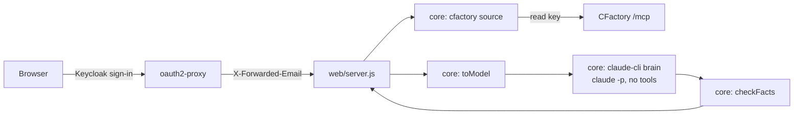

# Spec: Phase 1a, a text standup in the web UI

## Design

### Where it sits

Phase 1a is the first slice of the RFactory web app. It builds on the
`core/` package that #2 slice S1 defines and approved
(`spec/2026-11-17-2-standalone-mode.md`, `plan/2026-11-17-2-standalone-mode.md`
on `feat/2-standalone-mode`). It reuses, unchanged:

- the item model `{ id, title, url, state: done|in_progress|blocked|left|unknown,
  source_state, assignees, updated_at, evidence[] }` and `summarise(items)`
  (`core/src/items.js`);
- `toModel()`, the one redactor for everything that goes to a brain, the
  logs and any stored text (`core/src/redact.js`);
- `checkFacts(text, snapshot)` (`core/src/facts.js`);
- the destination hash and its check before every turn
  (`core/src/brains/destination.js`).

1a adds three things on top: a CFactory source adapter, a Claude Code CLI
brain with no tools, and a small web server behind sign-in.

**Order of work:** 1a is implemented after #2 S1 steps 1 to 7 are merged to
`main`. 1a's plan only adds files; it does not change `core/` files that #2
owns, other than registering the new source and brain.

### CFactory source (`core/src/sources/cfactory.js`)

- **Client.** The MCP SDK that #2 already pins (`@modelcontextprotocol/sdk`
  1.32.2), Streamable HTTP transport, to CFactory `/mcp`, with
  `Authorization: Bearer <key>`. The key is a new `read`-scoped entry in
  CFactory's `CFACTORY_API_KEYS` (`cfk_…:read`,
  `CFactory/apps/backend/cfactory/auth.py:83-116`), added by the owner.
- **Tools used.** Only `cfactory_list_cards` and
  `cfactory_list_git_repositories`, both `read` in CFactory's `TOOL_SCOPES`
  (`mcp.py:920-976`). The adapter calls nothing else.
- **Scope.** A 1a scope is `{ source: "cfactory", repository_id: <n> }`.
  `cfactory_list_cards` is tenant-wide and has no repository filter
  (`mcp.py:242-256`), so the adapter filters on `repository_id` itself.
  At start-up it checks that the id exists in
  `cfactory_list_git_repositories`; otherwise the scope is refused.
- **State mapping.** CFactory's board status is the observed state
  (`cards.py:98`):

  | CFactory `status` | Item `state` |
  |---|---|
  | `done` | `done` |
  | `in_progress` | `in_progress` |
  | `blocked` | `blocked` |
  | `backlog`, `ready` | `left` |
  | anything else | `unknown`, listed with its raw `source_state` |

- **Fields kept.** `id` = `card_key`, `title`, `status` as `source_state`,
  `assignee`, `updated_at`, `issue_ref`. Everything else is dropped in the
  adapter, so it never reaches the brain, the logs or the page:
  `description`, `acceptance_criteria` and comments are **not** read in 1a.
- **Link.** CFactory's UI has no per-card URL (the cockpit links to the
  GitHub issue, `BacklogView.tsx:70`). So `url` is the GitHub issue from
  `issue_ref` (`owner/repo#n` → `https://github.com/owner/repo/issues/n`),
  and the card key is always shown next to it. A card with no
  `issue_ref` shows its key with no link. This is narrower than the
  intent's "linked to its CFactory card"; it is the only link CFactory has.
- **Evidence.** Two kinds, taken from fields the card already has:
  - each `stage_runs` entry whose `status` is `failed`, as
    `"<stage> (<service>) failed: <detail>"`. This is the nearest thing
    CFactory has to a blocked reason (there is no blocked-reason field);
  - a disagreement between the board and the issue, for example a
    `blocked` card whose `issue_state` is `closed`. As in #2, the board
    decides the state and the disagreement is listed; nothing is re-decided.
- **Data age.** `fetched_at` is the time of the `list_cards` call. The page
  also shows the newest `updated_at` among the scope's cards, because
  fresh data about stale cards is still stale.

### Claude Code CLI brain (`core/src/brains/claude-cli.js`)

1a has no follow-up questions, so the brain needs no tools at all. It gets
the snapshot in its prompt and writes the summary.

- **Command.**
  `claude -p --restricted --tools "" --strict-mcp-config --no-session-persistence --output-format json --system-prompt-file <fixed file>`,
  with the prompt on stdin. No `--mcp-config`: no MCP server is loaded.
  This is #2's Claude design with the gateway removed, which 1a doesn't
  need.
- **Process.** A dedicated `HOME` that holds only the subscription login,
  an environment with only `PATH`, `HOME` and `LANG` (no `ANTHROPIC_*`,
  proxy or base-URL variables), an empty working directory, and a 90 s
  timeout.
- **Pinned version.** The CLI version is part of the destination hash
  (#2's design). The version tested in the plan is recorded; a different
  version disables the brain until the owner approves it again.
- **Input.** `toModel(snapshot)`: card key, title, state, source state,
  assignee, `updated_at` and evidence lines, plus the counts from
  `summarise`. Card titles are wrapped as untrusted content, as in #2.
- **Output.** The CLI's JSON `result` text goes through `checkFacts`. A
  sentence that names a card key not in the snapshot, a wrong state or a
  wrong count is replaced with "I couldn't confirm that." `checkFacts`
  learns CFactory card keys (`[A-Z]+-\d+`) as a reference form, in addition
  to #2's GitHub forms.
- **Failure.** A timeout, a non-zero exit or a destination mismatch shows
  the board without a summary and says why. The board never depends on the
  brain.

### Web server (`web/`)

- **One Node process, `node:http`, no framework.** Two routes, both behind
  sign-in:
  - `GET /` serves one static page (`web/public/index.html`, plain HTML,
    CSS and a little JS, no build step).
  - `POST /api/standup` runs one standup for the configured scope and
    returns `{ items, counts, unknown, evidence, fetched_at,
    newest_update, summary | summary_error, destination }`.
- **The page** shows the four groups (done, in progress, blocked, left)
  with each card's key, title, link and evidence; an "unknown states"
  list; "as of <time>, <n> min ago" and the newest card update; the
  summary; and the brain's destination label (#2). It uses semantic HTML
  (headings, lists, a live region for the result) and works with the
  keyboard.
- **One standup at a time.** A second request while one runs gets `409`.
  This bounds the subscription use.
- **Configuration** is environment only: `CFACTORY_MCP_URL`,
  `CFACTORY_READ_KEY` (from a file, `CFACTORY_READ_KEY_FILE`),
  `RFACTORY_SCOPE_REPOSITORY_ID`, `RFACTORY_ALLOWED_EMAILS`,
  `RFACTORY_CLAUDE_HOME`, `PORT`. A key passed directly in the environment
  is refused, as in #2's "credential in scope" rule.

### Sign-in

- **Keycloak, the realm the Factories already use, through oauth2-proxy**,
  the same pattern as CFactory's cockpit (`CFactory/apps/backend/cfactory/config.py:300-316`).
  The app has no login code of its own.
- **Trust boundary.** The app listens on `127.0.0.1` (or the pod network
  only) and trusts `X-Forwarded-Email` because only oauth2-proxy can reach
  it. It still checks that header against `RFACTORY_ALLOWED_EMAILS` on every
  request and returns `403` otherwise, and `401` when the header is missing.
- **1a users:** the owner only. `RFACTORY_ALLOWED_EMAILS` holds one address.

### Data

- Card titles, states, assignees, dates and failed-stage details go to
  Claude through the subscription CLI. Descriptions, acceptance criteria
  and comments are never fetched.
- **Nothing is stored.** The last standup is kept in memory for the page
  and is lost on restart. Logs carry only `toModel()` output, with no card
  titles at `info` level.

### Where it runs

- **Development:** the owner's workstation, against CFactory on p620 with
  the read key.
- **Owner use:** a rootless podman container on p620, next to the
  Factories, after the owner's OK, the same way as the Phase 0 spike.
  oauth2-proxy runs as a second container in the same pod. Helm and the
  cluster come with 1b, when the call bot joins.

### Decisions on the intent's open questions (recommended)

| # | Question | Recommendation |
|---|---|---|
| 1 | Sign-in | Keycloak through oauth2-proxy, as CFactory does |
| 2 | First project | CFactory repository 2, `olafkfreund/aifactory-demo`, the default and the only one with cards (5 today: 4 blocked, 1 done) |
| 3 | Users | Owner only |
| 4 | Data | Titles, states, assignees, dates and failed-stage details go to Claude; no descriptions or comments; nothing stored |
| 5 | Where it runs | Workstation for development, podman pod on p620 for use |
| 6 | Follow-up questions | Not in 1a. They need the gateway as an MCP server for the CLI, which is #2 S2 |

## Alternatives rejected

- **React and Vite, like CFactory and PFactory.** One page with one button
  doesn't need a build. Revisit in 1b, when the live transcript arrives.
- **In-app OIDC (Authlib-style, as PFactory and AIFactory do).** More code
  and a session store to get right. oauth2-proxy is already proven in front
  of CFactory.
- **Giving the brain the gateway's four tools now.** That needs the gateway
  exposed as an MCP server to the CLI, which is #2 S2. A standup without
  questions doesn't need it, and zero tools is the smallest attack surface.
- **A deterministic summary with no brain.** It would work, but the
  parent intent makes the Claude CLI the first brain, and 1b needs the
  spoken-style text. The board itself stays deterministic.
- **Building 1a before #2 S1.** It would duplicate the item model, the
  redactor and the facts check, which #2 already specifies.
- **Reading card descriptions for richer summaries.** It sends more text
  to Claude and adds prompt-injection surface, for little gain in a
  standup.

## Risks

- **#2 S1 is not implemented yet.** 1a waits for it. If #2 S1 changes its
  interfaces, 1a's plan follows them.
- **The CLI's restrictions.** `--tools ""` and `--restricted` are flags of
  an evolving CLI (2.1.326 here). The plan tests that a run lists no tools
  and loads no MCP servers before the brain is offered; a failing check
  disables the brain, not the board.
- **Prompt injection through card titles.** Titles are untrusted. With no
  tools the brain can only write text, and `checkFacts` catches wrong IDs,
  states and counts. A misleading sentence with no ID or count can still
  get through; the board next to it is the source of truth.
- **The trusted header.** If the app port is reachable without
  oauth2-proxy, anyone can claim an email. Mitigation: bind to `127.0.0.1`
  in the pod and test that the port isn't published.
- **Stale CFactory data.** The current cards were last updated in
  September. The page shows the newest card update, so this is visible,
  not hidden.
- **Subscription use.** About one CLI call per standup, one at a time.
- **p620.** One extra pod (Node and oauth2-proxy); no NixOS or service
  changes; nothing built or deployed without the owner's OK.

## Verification

1. `cd core && npm test`: the new tests pass along with #2's:
   - the CFactory state mapping, including an unknown status;
   - the `repository_id` filter, an unknown repository refused;
   - `issue_ref` to URL, and a card with no `issue_ref`;
   - failed `stage_runs` and board/issue disagreement as evidence;
   - descriptions and acceptance criteria never present in the items;
   - `checkFacts` with card keys: a made-up `FCT-99`, a wrong state, a
     correct one;
   - the Claude brain's argv and environment (asserted, as
     `nixarchy-microvm` does), a timeout, and a destination mismatch.
2. `cd web && npm test`: `401` without the header, `403` for another
   email, `409` for a concurrent standup, a direct key in the environment
   refused, and `/api/standup` against a fake source and brain.
3. **CLI check:** a real `claude -p` run with the 1a flags reports no tools
   and no MCP servers.
4. **End to end on the workstation,** against CFactory with the read key:
   the page shows the five cards of repository 2 in the right groups, the
   failed stages as evidence, the data age, and a checked summary.
5. **On p620,** after the owner's OK: the owner signs in through Keycloak
   and sees the same; another account gets `403`; the app port is not
   reachable from outside the pod.
