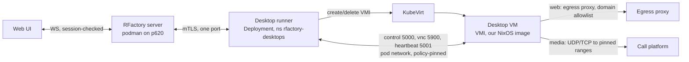

# Spec revision: desktops as KubeVirt VMs in the k3d cluster

Owner decision (2026-11-18): the desktop VMs run inside the k3d `factory`
cluster on p620 with KubeVirt, not on the host with a systemd runner. This
file changes only what it names. Every other decision of the approved spec
`spec/2026-11-17-3-agent-workspace.md` stays: driving apps through
Playwright with an origin allowlist, handover and the approval queue, the
share with its nonce, track label and `displaySurface` checks, LUKS
profiles opened in guest memory, the live view, the AI disclosure, and the
intent's network constraint (the guest reaches only the call platform and
approved preview hosts).

## Facts this rests on (checked on p620, 2026-11-18)

- k3d cluster `factory`, k3s v1.31.5: one server and one agent node. Both
  nodes are privileged Docker containers, so they see the host's
  `/dev/kvm`, which is `crw-rw-rw-`. p620 has 128 cores and 251 GiB of RAM.
- Network: flannel with k3s's built-in NetworkPolicy controller. Policies
  are already in use (argocd). Pod CIDR `10.42.0.0/16`, service CIDR
  `10.43.0.0/16`, node network `172.18.0.0/16`.
- `--disable=servicelb` and `--disable=traefik` are set.
- Apps are deployed by ArgoCD from `github.com/olafkfreund/factory-gitops`
  (`apps/<name>/manifests`).
- Kyverno runs admission policies, including
  `require-first-party-signature-coverage` and
  `gate-task-pods-on-network-policy`.
- KubeVirt and Kata are not installed. The cluster has no VM layer.

## Design

### Shape

- **KubeVirt**, pinned to one release, is installed by ArgoCD
  (`factory-gitops`, `apps/kubevirt`). It uses hardware KVM; software
  emulation is never enabled, and the plan's first step proves that.
- **Namespace `rfactory-desktops`** holds the runner, the egress proxy and
  the VMs, and nothing else.
- **The runner** keeps its HTTP API (`create`, `destroy`, `list`,
  `heartbeat`, `action`, `share-*`, `profile-*`, `cancel`, `/call`,
  `/vnc`) and its mTLS client checks.
  - It is now a Deployment with a ServiceAccount whose Role covers only
    VMIs, Services, NetworkPolicies, PVCs and ConfigMaps in its own
    namespace.
  - It is exposed on `127.0.0.1` of p620 through the k3d load balancer on
    one port, mTLS only.
  - Its lifecycle logic (heartbeats, idle, runtime limit, spare, capacity,
    the share watchdog, cancel) is unchanged.
  - Its host layer is replaced: no systemd-run, taps, nft tables, dnsmasq
    or `microvm-run` copies.
- **The guest** is the same NixOS image: Xvfb, the call Chrome with the
  bot, the control Chrome as `rfchrome`, the agent and x11vnc.
  - It is built as a disk image and shipped as a KubeVirt `containerDisk`:
    read-only and ephemeral per VMI, which matches "one read-only image,
    nothing kept".
  - The image is imported into the cluster with `k3d image import` and
    pinned by digest.
- **Guest identity:** the runner records each VMI's pod IP when it is
  scheduled. Every message arriving on the control or heartbeat ports is
  tagged from that IP-to-desktop map, never from anything the guest
  sends, the same rule as the vsock CID map.
  - The guest listens on 5000 and 5900; the runner listens on 5001.
  - NetworkPolicy allows those ports only between the runner pod and that
    VMI. KubeVirt's masquerade binding gives the guest only its pod's
    address.

### Network (replaces the approved "Network" section)

Default deny is enforced by NetworkPolicy, with one policy per desktop
made by the runner:

1. **Namespace default:** all egress and ingress are denied for VMI pods.
2. **Never reachable** (no policy ever allows them):
   - the pod CIDR (other than the runner and proxy pods);
   - the service CIDR;
   - the node network `172.18.0.0/16`;
   - p620's LAN and Tailscale addresses;
   - RFC1918, CGNAT, link-local and `169.254.169.254`;
   - every other desktop.

   Every ipBlock carries these as `except`.
3. **Web traffic** goes through the namespace's **egress proxy**, which is
   the only TCP destination besides the media ranges.
   - The proxy filters CONNECT and SNI per desktop, by source IP: the
     platform allowlist plus that scope's preview allowlist.
   - Chrome in the guest is started with `--proxy-server` and
     `--proxy-bypass-list=<-loopback>`.
   - The guest's DNS goes only to the proxy's resolver, which answers only
     allowlisted names.
4. **Media:** UDP and TCP go directly to the call platform's **pinned
   published media ranges** as ipBlocks: Meet, Zoom, Teams (deviation 26)
   and Slack, all already pinned in `desktop/ranges/ranges.json`. WebRTC
   media cannot pass an HTTP proxy, so media is never proxied.
5. **Private previews:** an admin-approved `ip:port` for one scope is
   added to that desktop's policy as an ipBlock with a port. It can never
   fall inside the ranges in rule 2, and the runner refuses one that does.
6. **Kyverno** gets one policy that refuses any NetworkPolicy in
   `rfactory-desktops` allowing rule 2's ranges, and any Pod there with
   `hostNetwork` or `privileged`.

### Lifecycle

- Each desktop is a VMI labelled with its `desktop_id`, `call_id` and
  scope, and owned by the runner's Deployment.
- `destroy` deletes the VMI and its policy, and waits until both are gone.
- On start, the runner lists labelled VMIs and deletes any it does not
  know, the same rule as today's "runner restart does not keep VMs".
- Limits move into the VMI spec and a namespace ResourceQuota:
  - each VMI: 2 vCPU and 3 GiB, the measured sizing in step 17;
  - the quota caps the namespace at `maxDesktops` VMs;
  - `RuntimeMaxSec` becomes the runner's runtime limit plus
    `activeDeadlineSeconds` on the launcher pod.

### Profiles

- Each LUKS profile is a PVC (`local-path`) attached to the VMI as a
  second disk.
- The key is sent over the control channel exactly as now: one key per
  profile, derived on the runner, never on disk in the guest.
- Plaintext exists only in guest memory.

### Live view

- x11vnc in the guest, port 5900, reached by the runner over the pod
  network (policy-pinned). The runner bridges it to `/vnc/<id>` as today.
- KubeVirt's own VNC console is not used: it shows the VM's virtual
  screen, not the Xvfb display the agent drives.

### What is removed

`desktop/nixos/runner.nix` and the sample host; the host network layer
(`net.js` nft and dnsmasq, taps, NAT); the vsock bridges and the identity
oneshot's vsock CID read; the per-VM `microvm-run` copies; the p620 NixOS
change. The probe image becomes a VMI too, for `net.sh`.

## Alternatives rejected

- **The host runner (approved design):** the owner chose the cluster, so
  the VMs are managed with the other Factory services through GitOps.
- **Kata Containers with Cloud Hypervisor:**
  - in k3d it means installing a runtime into the Docker node's containerd
    (kata-deploy), which is fragile when the nodes are recreated;
  - the guest would become a container rootfs on Kata's kernel, not our
    NixOS image.
- **Plain pods:** a container boundary is too weak for an agent that
  browses and types, as the approved spec says.
- **FQDN egress in NetworkPolicy:** k3s's policy controller has no FQDN
  rules. The proxy and DNS allowlist do that job, and ipBlocks carry the
  media.
- **The proxy alone:** it cannot carry WebRTC UDP, so media stays on
  ipBlocks.
- **KubeVirt's VNC console for the live view:** it shows the wrong
  display.

## Risks

- **Untrusted browsing inside the cluster that runs Factory.** Isolation
  now rests on NetworkPolicy enforcement for VMI pods plus the VM
  boundary, where before it rested on host nftables outside the cluster.
  Mitigations:
  - default deny and `except` blocks on every rule;
  - the Kyverno guard;
  - `net.sh` proving each protected range unreachable from a probe VMI.
- **KubeVirt inside Docker-hosted k3s nodes** depends on the node
  containers seeing `/dev/kvm` and on cgroup v2 delegation. Recreating the
  cluster must keep the nodes privileged. The first plan step is a gate:
  a VMI boots with KVM, or this revision stops.
- **Kyverno's first-party signature policy** may refuse KubeVirt's or our
  images. The owner decides on an exception scoped to `kubevirt` and
  `rfactory-desktops`.
- **The k3d load balancer** needs one new port mapping, which is a cluster
  change made with `k3d node edit` and announced on the agent bus.
- **More moving parts** (KubeVirt's operator, handler and launcher pods)
  on a shared cluster: KubeVirt gets its own namespace, and its resource
  use is measured in step 17.
- **Time:** the guest, web, share, approval and scripts work carries
  over; the runner's host layer is rewritten.

## Verification

1. **Gate, on p620 with the owner's OK:**
   - KubeVirt installed through ArgoCD;
   - a probe VMI boots our image with KVM (`/dev/kvm` in the launcher,
     no `useEmulation`);
   - from inside it, rule 2's ranges are unreachable and a pinned media
     range is reachable.
2. **Unit tests:** the runner's Kubernetes client is faked (VMI, policy and
   PVC create, delete and list), with the same lifecycle tests as now. The
   policy generator is tested: `except` is on every rule, and a preview
   inside a protected range is refused. The proxy allowlist is tested per
   source IP.
3. **Step 17's checklist**, re-pointed:
   - `net.sh` runs from a probe VMI;
   - `lifecycle.sh` uses VMI deletion and runner restart;
   - `profiles.sh` uses PVCs;
   - everything else is unchanged.
4. **Live, with the owner:** a Meet call and a Teams call joined from a
   desktop VMI, with handover, an approved share and Stop. Nothing of the
   VM is left afterwards: no VMI, no policy, no PVC except attached
   profiles.
