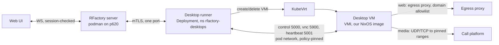

# Spec revision: desktops as KubeVirt VMs in the k3d cluster

Owner decision (2026-11-18): the desktop VMs run inside the k3d `factory`
cluster on p620 with KubeVirt, not on the host with a systemd runner. This
file changes only what it names. Every other decision of the approved spec
`spec/2026-11-17-3-agent-workspace.md` stays: driving apps through
Playwright with an origin allowlist, handover and the approval queue, the
share with its nonce, track label and `displaySurface` checks, LUKS
profiles opened in guest memory, the live view, the AI disclosure, and the
intent's network constraint (the guest reaches only the call platform and
approved preview hosts).

## Facts this rests on (checked on p620, 2026-11-18)

- k3d cluster `factory`, k3s v1.31.5: one server and one agent node. Both
  nodes are privileged Docker containers, so they see the host's
  `/dev/kvm`, which is `crw-rw-rw-`. p620 has 128 cores and 251 GiB of RAM.
- Network: flannel with k3s's built-in NetworkPolicy controller. Policies
  are already in use (argocd). Pod CIDR `10.42.0.0/16`, service CIDR
  `10.43.0.0/16`, node network `172.18.0.0/16`.
- `--disable=servicelb` and `--disable=traefik` are set.
- Apps are deployed by ArgoCD from `github.com/olafkfreund/factory-gitops`
  (`apps/<name>/manifests`).
- Kyverno runs admission policies, including
  `require-first-party-signature-coverage` and
  `gate-task-pods-on-network-policy`.
- KubeVirt and Kata are not installed. The cluster has no VM layer.

## Design

### Shape

- **KubeVirt**, pinned to one release, is installed by ArgoCD
  (`factory-gitops`, `apps/kubevirt`). It uses hardware KVM; software
  emulation is never enabled, and the plan's first step proves that.
- **Namespace `rfactory-desktops`** holds the runner, the egress proxy and
  the VMs, and nothing else.
- **The runner** keeps its HTTP API (`create`, `destroy`, `list`,
  `heartbeat`, `action`, `share-*`, `profile-*`, `cancel`, `/call`,
  `/vnc`) and its mTLS client checks.
  - It is now a Deployment with a ServiceAccount whose Role covers only
    VMIs, Services, NetworkPolicies, PVCs and ConfigMaps in its own
    namespace.
  - It is exposed on `127.0.0.1` of p620 through the k3d load balancer on
    one port, mTLS only.
  - Its lifecycle logic (heartbeats, idle, runtime limit, spare, capacity,
    the share watchdog, cancel) is unchanged.
  - Its host layer is replaced: no systemd-run, taps, nft tables, dnsmasq
    or `microvm-run` copies.
- **The guest** is the same NixOS system (Xvfb, the call Chrome with the
  bot, the control Chrome as `rfchrome`, the agent, x11vnc), converted for
  KubeVirt:
  - **Boot:** KubeVirt `kernelBoot`. The kernel and initrd come from a
    small container image, and the root is a read-only erofs `containerDisk`
    mounted `readonly: true`. Every writable path (`/tmp`, `/home`, browser
    state, the overlay) is a tmpfs in guest memory with a size limit
    (4 GiB in total). Nothing the guest writes reaches node storage; the
    gate proves it (below).
  - **Network:** DHCP on the masquerade interface (KubeVirt serves
    `10.0.2.2/24`, gateway `10.0.2.1`). DNS points only at the proxy's
    resolver. The agent and x11vnc bind the guest address, and the guest
    firewall accepts 5000 and 5900 only from the gateway. The vsock
    bridges and the CID identity oneshot are removed.
  - The images are imported with `k3d image import` and pinned by digest.
- **The desktop guard** is a small DaemonSet in `rfactory-desktops`. It
  is the per-VM enforcement point that NetworkPolicy alone cannot be: it
  runs with `hostNetwork` and `NET_ADMIN` on each node, and touches only
  the veths of pods labelled as desktops. Kyverno allows `hostNetwork`
  only for this one DaemonSet. Per desktop it enforces:
  - **anti-spoofing:** a packet from the launcher pod's veth whose source
    is not that pod's IP is dropped and counted (KubeVirt's masquerade
    SNATs only the expected guest address);
  - **startup gate:** the VMI is created with `startStrategy: Paused`. The
    guard installs the desktop's rules, then proves one allowed and one
    denied connection from that pod's network namespace, and only then
    tells the runner, which unpauses the VMI. No guest instruction runs
    before isolation holds;
  - **bandwidth and quota:** 20 Mbit/s with `tc` on the veth, and a byte
    counter that cuts all egress at 1 GiB per call and reports it (the
    approved limits);
  - **runner loss:** the guard expects the runner's heartbeat. After 60 s
    without one it cuts all of that desktop's egress, so a share or call
    cannot continue after its controller disappears. This works even when
    the API server is unreachable.
- **Guest identity:** a desktop is the VMI's UID together with its launcher
  pod's UID and pod IP, all recorded by the runner when the VMI is
  scheduled. Messages on 5000 and 5001 are tagged from that record, never
  from anything the guest sends. The guard's anti-spoofing is what makes
  the pod IP trustworthy.

### Network (replaces the approved "Network" section)

1. **Namespace default:** NetworkPolicy denies all ingress and egress for
   launcher pods. The guard additionally drops each desktop's traffic
   until its own rules are in place (the startup gate).
2. **Never reachable:**
   - the pod CIDR (other than the runner and proxy pods);
   - the service CIDR;
   - the node network `172.18.0.0/16`;
   - p620's LAN and Tailscale addresses;
   - RFC1918, CGNAT, link-local and `169.254.169.254`;
   - every other desktop.

   No policy allows these. The policy generator emits only ipBlocks for
   allowed public ranges, with an `except` only where a protected range is
   contained in that block. Every generated manifest is validated with a
   server-side dry run. The guard drops these ranges on the veth as a
   second layer.
3. **Web traffic** goes only through the namespace's **egress proxy**:
   - CONNECT only, with the SNI matching the CONNECT host, else the
     connection is refused. Plain HTTP is refused, except for an approved
     private preview.
   - Per desktop, by source pod IP: the platform allowlist plus that
     scope's preview allowlist.
   - The proxy resolves each name once, checks every resolved address
     against rule 2, and connects to that checked address. A changed DNS
     answer cannot move a connection into a protected range.
   - The proxy pod has its own egress NetworkPolicy, public ranges only,
     with rule 2 excluded.
   - Chrome uses `--proxy-server`. The guest's only resolver is the
     proxy's, and it answers only allowlisted names.
4. **Media:** UDP and TCP go directly to the call platform's **pinned
   published media ranges** as ipBlocks: Meet, Zoom, Teams (deviation 26)
   and Slack, from `desktop/ranges/ranges.json`. WebRTC cannot go through
   an HTTP proxy.
5. **Private previews:** an admin-approved `ip:port` for one scope goes
   into that desktop's policy and the proxy's allowlist. The runner
   refuses one inside rule 2.
6. **Kyverno** policies scoped to `rfactory-desktops`, with
   `failurePolicy: Fail`:
   - refuse a NetworkPolicy that allows any rule 2 range;
   - refuse a Pod with `hostNetwork` or `privileged`, except the guard;
   - require signatures (or the pinned digests) for the runner, proxy,
     guard and guest images.

   The cluster's current signature policies cover only `factory`,
   `gateway`, `fides` and `fides-reporter`, and use `failurePolicy:
   Ignore`, so they say nothing about these images today.

### Lifecycle

- Each desktop is a VMI labelled with its `desktop_id`, `call_id` and
  scope. Its NetworkPolicy and proxy entry are created first, then the
  VMI (paused), and it is unpaused only after the guard's startup gate.
- `destroy` deletes the VMI, its policy and its proxy entry, and waits
  until all are gone.
- **Independent of the runner:** a separate **reaper** Deployment, with
  its own ServiceAccount allowed only to list and delete labelled VMIs,
  deletes any desktop whose runner Lease is stale for 60 s or whose age
  exceeds the runtime limit (3 h). Together with the guard's runner-loss
  cut, a dead or hung runner can neither keep a VM nor let it talk.
- On start, the runner deletes labelled VMIs it does not know.
- Limits:
  - each VMI: 2 vCPU and 3 GiB;
  - a ResourceQuota caps the namespace at `maxDesktops` VMIs;
  - bandwidth and the byte quota are enforced by the guard.

### Profiles

- Each profile is a filesystem PVC (`local-path`) holding one raw
  `disk.img`, created by the runner at profile creation with a fixed size,
  and attached to the VMI as a second disk with a fixed serial.
- **First attach:** the guest finds no LUKS header, `luksFormat`s the
  disk with the key sent over the control channel, then makes the
  filesystem. Later attaches open it. The key is one per profile, derived
  on the runner, never on disk in the guest. Plaintext exists only in
  guest memory.
- **Records and locking:** profile metadata (owner scope, expiry) lives in
  a ConfigMap per profile, owned by the runner. A profile attaches to at
  most one VMI, enforced by the runner's lock and checked at attach time
  against the list of VMIs (an RWO PVC alone does not prevent two VMIs on
  one node).

### Exposure

- The runner's Service is a NodePort on a fixed port.
- `k3d node edit k3d-factory-serverlb --port-add
  127.0.0.1:<port>:<nodeport>` maps p620's loopback to it. ServiceLB and
  Traefik stay disabled.
- mTLS only. The gate checks that p620 binds the port on `127.0.0.1`
  only.

### Live view

- x11vnc in the guest on port 5900, reached by the runner over the pod
  network (policy-pinned), bridged to `/vnc/<id>` as today.
- KubeVirt's own VNC console is not used: it shows the VM's virtual
  screen, not the Xvfb display the agent drives.

### What is removed

- `desktop/nixos/runner.nix` and the sample host;
- the vsock bridges and the CID identity oneshot;
- the per-VM `microvm-run` copies;
- the p620 NixOS change.

The host nft and `tc` code moves into the guard, which applies it per veth
instead of per tap. The probe image becomes a VMI too, for `net.sh`.

## Alternatives rejected

- **The host runner (approved design):** the owner chose the cluster, so
  the VMs are managed with the other Factory services through GitOps.
- **Kata Containers with Cloud Hypervisor:**
  - in k3d it means installing a runtime into the Docker node's containerd
    (kata-deploy), which is fragile when the nodes are recreated;
  - the guest would become a container rootfs on Kata's kernel, not our
    NixOS image.
- **Plain pods:** a container boundary is too weak for an agent that
  browses and types, as the approved spec says.
- **FQDN egress in NetworkPolicy:** k3s's policy controller has no FQDN
  rules. The proxy and DNS allowlist do that job, and ipBlocks carry the
  media.
- **The proxy alone:** it cannot carry WebRTC UDP, so media stays on
  ipBlocks.
- **KubeVirt's VNC console for the live view:** it shows the wrong
  display.

## Risks

- **Untrusted browsing inside the cluster that runs Factory.** Isolation
  rests on the VM boundary plus two layers: NetworkPolicy and the guard's
  per-veth rules (anti-spoofing, protected drops, startup gate). Before,
  it was host nftables outside the cluster. The gate proves each layer
  separately.
- **The guard is privileged** (`hostNetwork`, `NET_ADMIN`) on a shared
  cluster:
  - it is small, uses argv only, and touches only labelled pods' veths;
  - Kyverno allows that exception for it alone;
  - a guard bug could affect other pods' networking, so its rules are
    named per desktop and removed with it.
- **KubeVirt inside Docker-hosted k3s nodes** depends on `/dev/kvm` in the
  node containers and on cgroup v2 delegation. Recreating the cluster must
  keep the nodes privileged. The gate stops the revision if a VMI does not
  boot with KVM.
- **Startup race:** kube-router programs a new pod's rules after a delay
  (documented by the live `gate-task-pods-on-network-policy`). The paused
  start and the guard's gate close it. The gate tests it.
- **Proxy as a confused deputy:** protected-address checks on every
  resolved address, its own egress policy, and SNI matching.
- **More moving parts** on a shared cluster: KubeVirt's operator, handler
  and launcher pods, plus the guard, reaper and proxy. KubeVirt gets its
  own namespace, and resource use is measured at step 17.
- **Time:** the guest, web, share, approval and scripts work carries over.
  The runner's host layer is rewritten as Kubernetes calls plus the guard.

## Verification

1. **Gate, on p620 with the owner's OK** (stops the revision on any
   failure):
   - KubeVirt installed through ArgoCD.
   - A probe VMI boots with KVM: `/dev/kvm` in the launcher, no
     `useEmulation`.
   - From the probe: every rule 2 range is unreachable over TCP and UDP;
     a pinned media range and the proxy are reachable.
   - A spoofed source address is dropped (the guard's counter rises).
   - Traffic sent the moment the VMI is unpaused is still filtered.
   - With the runner stopped, egress is cut within 60 s and the reaper
     deletes the VMI.
   - The proxy refuses a CONNECT to a name that resolves into rule 2, and
     a CONNECT/SNI mismatch.
   - After a forced VMI kill, no file on the node contains a marker the
     guest wrote.
   - A new profile disk is formatted on first attach, and a second attach
     is refused.
   - The runner's port is bound on `127.0.0.1` only.
   - The bandwidth limit and the 1 GiB cutoff hold.
2. **Unit tests:**
   - the runner's Kubernetes client is faked (VMI, policy, PVC and Lease),
     with the same lifecycle tests as now;
   - the policy generator: only contained `except` blocks, a protected
     preview refused, and every manifest passes a schema check;
   - the guard's rule builder: anti-spoofing, protected drops, quota and
     runner-loss cut;
   - the proxy: allowlist per source IP, protected-address checks after
     resolution, SNI match;
   - the reaper: stale Lease and age.
3. **Step 17's checklist**, re-pointed:
   - `net.sh` runs from a probe VMI;
   - `lifecycle.sh` adds runner-loss and reaper cases;
   - `profiles.sh` uses PVCs;
   - everything else is unchanged.
4. **Live, with the owner:** a Meet call and a Teams call joined from a
   desktop VMI, with handover, an approved share and Stop. Nothing of the
   VM is left afterwards: no VMI, policy or proxy entry, and no PVC
   except attached profiles.
